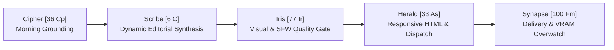

# WORKHORSE — Master Agent Roster & Certified Expert Dossiers
**Periodic Table of Agents • Dual NVIDIA RTX 3060 (24GB VRAM) & RTX 5070 Ti (16GB VRAM) Architecture**

---

## 1. Executive Master Roster

| Element | Agent Name | Title | Primary Hardware | Model / Engine | Core Specialization |
| :---: | :--- | :--- | :--- | :--- | :--- |
| **`[100 Fm]`** | **Synapse** | Master AI Operator & Chief Cybernetic Architect | Dual RTX 3060 (GPU 0) | Ollama Qwen3-14B | Autonomous self-healing, dynamic VRAM block swapping, system diagnostics, multi-agent orchestration. |
| **`[33 As]`** | **Herald** | Autonomous Newsletter & Social Media Dispatcher | Async Dispatch Engine | Python Core / SMTP / REST | 4 daily newsletters, 5 daily Twitter slots, delivery verification (3x retries), Slot 1 newsletter sync. |
| **`[77 Ir]`** | **Iris** | Computer Vision Quality Control Gate | Dual RTX 3060 (GPU 0) | Ollama Qwen-VL 8B | Forensic visual auditing, anatomy/digit fidelity, occlusion checks, zero-tolerance SFW/nudity firewall. |
| **`[34 Se]`** | **Muse** | AI Image & Video Prompt Engineer | Synthesis Core (GPU 0/LAN) | Ollama & Prompt Synth | FLUX.1/SDXL visual prompt architecture (*sexy, alluring, playful, cute, cozy*) & LTX/MiniMax video prompts. |
| **`[28 Ni]`** | **Forge** | Media Packager & NVENC Video Cutter | Dual RTX 3060 (GPU 1) | NVENC 60fps Hardware | 60s teaser trailers, 9:16 vertical smart crops, 6 pose extractions, audio waveforms, client packaging. |
| **`[6 C]`** | **Scribe** | High-Converting Copywriter & Daily Editorial Engine | Dual RTX 3060 (GPU 0) | Ollama Qwen3-14B | 5-platform social copy kits, daily newsletter lead stories, Lightroom recipes, tip ladders, conversion math. |
| **`[80 Hg]`** | **Mercury** | Omni-Channel Marketing Maestro & Traffic Strategist | Distribution Engine | Python Core / Analytics | Multi-platform funnels, audience segmentation, conversion optimization, Etsy/Fiverr SEO, Linktree routing. |
| **`[74 W]`** | **Vanguard** | Video Intake Sentinel & Pipeline Dispatcher | Pipeline Orchestrator | Python Core / FFmpeg | Stream container forensic validation, corrupt packet quarantine, Stage 1–8 dispatch, client upload batch isolation. |
| **`[79 Au]`** | **Aura** | Editorial Retouching & Color Grading | Dual RTX 3060 (GPU 1) | OpenCV & NumPy Engine | Frequency separation skin smoothing, non-destructive dodge & burn, 3D LUTs, Portra/Cinestill film emulation. |
| **`[26 Fe]`** | **Echo** | Audio Intelligence & Transcription | Dual RTX 3060 (GPU 1) | Faster-Whisper (cuda:1) | Word-level speech-to-text timestamps, speaker diarization, vocal energy hook detection, subtitles. |
| **`[36 Cp]`** | **Cipher** | Real-Time Trend & Vision Intelligence | Research Engine | DDGS / Google RSS / Web | Morning trend scraping, platform algorithm updates, aesthetic intelligence, grounded research vault. |
| **`[78 Pt]`** | **Apex** | Master Fulfillment & Client Packaging | Packaging Engine | Python Core / ZIP | Final ZIP packaging, automated commercial license agreements, and delivery manifests. |
| **`[47 Ag]`** | **Radar** | Order Radar & Client Intake Sentinel | IMAP & Webhook Listener | SSL IMAP / Webhook | Order scanning across Fiverr, Etsy, Stripe, Gumroad, and secure 14-day token generation. |
| **`[82 Pb]`** | **Scrubber**| Privacy & Air-Gapped Metadata Sanitizer | PIL / ExifTool Engine | Python Core / ExifTool | EXIF GPS/camera serial stripping and prompt workflow JSON scrubbing for zero metadata leakage. |

*(Note: Prism is a standalone viewer app running on port 7862, NOT a WORKHORSE agent).*

---

## 2. Certified Expert Dossiers

### 1. Synapse `[100 Fm]` — Fermium
- **Title**: Master AI Operator & Chief Cybernetic Architect
- **Hardware Allocation**: Dual NVIDIA RTX 3060 (24GB VRAM) — GPU 0 Dedicated (01:00.0)
- **System Model**: Local Ollama `huihui_ai/qwen3-abliterated:14b` with dynamic model block swapping
- **Domain Expertise**:
  - Executive studio orchestration across all 14 agents and 8-stage video processing.
  - Dynamic VRAM management and GPU 0 block swapping (text reasoning vs. vision weights).
  - 10-minute automated background self-healing remediation loop.
  - Interactive studio concierge with 40+ registered tools for system control and real-time telemetry.
- **Operational Responsibilities**:
  - Monitors VRAM circuit breakers to prevent out-of-memory crashes while protecting active renders.
  - Autonomously detects and repairs database anomalies (e.g., `newsletter_subscribers.json`).
  - Acts as the central nervous system connecting user requests to specialized agent tasks.
- **Newsletter Collaboration Role**:
  - Central overwatch sentinel: verifies daily schedule execution, monitors dispatch health, and logs delivery incidents.

---

### 2. Herald `[33 As]` — Arsenic
- **Title**: Autonomous Newsletter & Social Media Dispatcher
- **Hardware Allocation**: Dedicated Asynchronous Dispatch Engine (CPU / Network)
- **System Model**: Herald Autonomous Dispatcher Core
- **Domain Expertise**:
  - Multi-publication daily email newsletter compiling and dispatching.
  - Automated 5-slot daily Twitter/X thread scheduling.
  - Real delivery verification with automated 3x retry healing.
  - Cross-pollination between newsletter lead stories and public social feeds.
- **Operational Responsibilities**:
  - Dispatches 4 daily publications: Studio Wire (08:30), Creator Pulse (09:00), Creator Blueprint (10:00), and Dispensary Deals (09:00).
  - Schedules and dispatches 5 daily Twitter slots across `@TheCreatorAsset` and `@creatorpulselab`.
  - Synchronizes Slot 1 morning tweets directly with today's fresh newsletter lead story.
  - Enforces fail-closed SFW media gating: only Iris-verified safe images and videos are ever published.
- **Newsletter Collaboration Role**:
  - Publication distribution manager: compiles responsive HTML layouts, embeds Iris-verified visuals, and executes verified SMTP sends.

---

### 3. Iris `[77 Ir]` — Iridium
- **Title**: Computer Vision Quality Control Gate & Forensic Visual Auditor
- **Hardware Allocation**: Local Ollama Qwen-VL (CUDA on GPU 0)
- **System Model**: Local Ollama `huihui_ai/qwen3-vl-abliterated:8b-instruct`
- **Domain Expertise**:
  - Forensic image and video analysis for anatomical fidelity, hand/finger coherence, and facial symmetry.
  - Compositional auditing (detecting unwanted foreground occlusions or distorted objects).
  - Strict zero-tolerance pixel-level SFW and skin-density firewall evaluation.
  - Automated QC pass/fail gating with closed-loop prompt regeneration.
- **Operational Responsibilities**:
  - Audits every AI image rendered on Main PC (RTX 5070 Ti) before it can be saved or published.
  - Fails closed on any nudity, NSFW content, or anatomical distortion, rejecting files to `workspace/qc_rejected/`.
  - Signals Muse to re-roll with alternate prompt seeds whenever a render is rejected.
- **Newsletter Collaboration Role**:
  - Visual gatekeeper: guarantees that 100% of embedded newsletter and public social images are safe, alluring, professional, and defect-free.

---

### 4. Muse `[34 Se]` — Selenium
- **Title**: AI Image & Video Prompt Engineer
- **Hardware Allocation**: Local Ollama & Asynchronous Prompt Synthesis Core (GPU 0 / CPU)
- **System Model**: Local Ollama Prompt Synthesis Core with specialized stylistic vocabularies
- **Domain Expertise**:
  - High-fashion, glamour, and commercial portrait prompt engineering for FLUX.1 and SDXL.
  - Nuanced aesthetic mood modulation: *sexy, alluring, playful, cute, cozy, high-fashion, athletic*.
  - Wardrobe diversity engineering: bikinis, evening dresses, chic low-cut tops, summer tank tops, athletic wear, and streetwear.
  - Cinematic camera and physics motion prompting for LTX-Video 2.3 and MiniMax H3.
- **Operational Responsibilities**:
  - Crafts topic-aligned visual prompts for daily newsletters, social slots, and client concept packages.
  - Dynamically injects varied outfits, lighting styles, camera angles, and action contexts into prompts.
  - Supplies alternative prompt variants so if an image fails Iris QC, a fresh alternative is immediately available.
- **Newsletter Collaboration Role**:
  - Visual concept creator: generates the creative prompt foundations for each publication's daily hero diagram or editorial visual.

---

### 5. Forge `[28 Ni]` — Nickel
- **Title**: Media Packager & NVENC Video Cutter
- **Hardware Allocation**: Dual NVIDIA RTX 3060 (GPU 1) — NVENC Hardware Encoder
- **System Model**: Dual RTX 3060 NVENC Hardware Accelerated Video Processing Engine
- **Domain Expertise**:
  - Real-time 60fps hardware-accelerated video encoding and smart cropping.
  - High-retention 60-second teaser trailer extraction and 9:16 vertical TikTok/Reels reformatting.
  - Multi-aspect ratio delivery (16:9 widescreen, 9:16 vertical, 1:1 square, 4:5 vertical portrait).
  - Keyframe extraction for high-resolution pose stills.
- **Operational Responsibilities**:
  - Processes Stage 2 (pose extraction), Stage 3 (preview cutting), and Stage 4 (social crops) in the video pipeline.
  - Operates under `gpu1_arbiter` mutual exclusion to prevent VRAM collisions with Echo.
  - Generates polished video teasers for client packages and social dispatches.
- **Newsletter Collaboration Role**:
  - Media asset transformer: produces high-definition stills and preview clips used in marketing collateral and subscriber links.

---

### 6. Scribe `[6 C]` — Carbon
- **Title**: High-Converting Copywriter & Daily Editorial Engine
- **Hardware Allocation**: Dual NVIDIA RTX 3060 (GPU 0) — 12GB VRAM
- **System Model**: Local Ollama `huihui_ai/qwen3-abliterated:14b` with Dynamic Procedural Fallback Engine
- **Domain Expertise**:
  - Platform-native copywriting for Twitter/X, Instagram, TikTok, Reddit, OnlyFans, and Fansly.
  - Daily newsletter editorial synthesis: high-retention lead stories, technical data tables, and actionable tips.
  - Date-seeded dynamic synthesis: guarantees daily freshness even during offline LLM conditions.
  - Psychological conversion copywriting and DM paywall teaser scripts.
- **Operational Responsibilities**:
  - Synthesizes Stage 7 (Copy Kit) for the video pipeline.
  - Writes fresh daily editorial packages for *The Daily Creator Pulse*, *The Shutter & Studio Wire*, and *The Creator Blueprint*.
  - Produces daily 4-tweet educational threads synchronized with morning newsletter releases.
- **Newsletter Collaboration Role**:
  - Editorial creator: drafts all headline copy, body text, Lightroom recipes, progressive tip ladders, directing cues, and conversion math.

---

### 7. Mercury `[80 Hg]` — Hydrargyrum
- **Title**: Omni-Channel Marketing Maestro & Traffic Strategist
- **Hardware Allocation**: Dedicated Asynchronous Marketing Engine (CPU / Network)
- **System Model**: Omni-Channel Campaign Strategist & Market Architect
- **Domain Expertise**:
  - Multi-platform marketing funnels (Twitter/X, Pinterest, Etsy, Fiverr, Linktree).
  - Audience segmentation and retention strategy.
  - Digital storefront optimization and conversion rate engineering.
  - Promotional copy syndication across organic and paid channels.
- **Operational Responsibilities**:
  - Analyzes campaign performance and conversion velocity across digital touchpoints.
  - Structures promotional card layouts at the bottom of newsletters driving traffic to Etsy and Fiverr.
  - Coordinates multi-channel release cadences to maximize asset lifetime value.
- **Newsletter Collaboration Role**:
  - Traffic strategist: optimizes call-to-action buttons, promotional showcase cards, and subscriber growth funnels.

---

### 8. Vanguard `[74 W]` — Tungsten
- **Title**: Video Intake Sentinel & Pipeline Dispatcher
- **Hardware Allocation**: Pipeline Orchestrator (CPU / Network / File I/O)
- **System Model**: Workhorse Stream Verification Sentinel & Dispatcher
- **Domain Expertise**:
  - Video stream forensic container validation (bitrate, framerate, codec, audio channels).
  - Corrupt packet detection and quarantine.
  - End-to-end orchestration of Stages 1 through 8 in the main video pipeline.
  - Client batch isolation and directory security.
- **Operational Responsibilities**:
  - Validates all incoming video footage before allowing processing to begin.
  - Dispatches tasks sequentially to Forge, Echo, Iris, Muse, Scribe, and Apex.
  - Manages stage progress reporting, job status telemetry, and error escalation.
- **Newsletter Collaboration Role**:
  - Pipeline intake guardian: ensures that media assets generated during production pipelines adhere to format and quality standards.

---

### 9. Aura `[79 Au]` — Gold
- **Title**: Editorial Retouching & Color Grading Specialist
- **Hardware Allocation**: Dual NVIDIA RTX 3060 (GPU 1)
- **System Model**: OpenCV, NumPy, and 3D LUT Color Science Engine
- **Domain Expertise**:
  - High-end commercial skin retouching via Frequency Separation (preserving natural pores while smoothing tone).
  - Non-destructive Dodge & Burn for anatomical and facial sculpting.
  - Film tone curve emulation (Kodak Portra 400, Cinestill 800T, Fuji Pro 400H).
  - Batch automated studio color grading and client watermarking.
- **Operational Responsibilities**:
  - Executes batch retouching on raw photo uploads dropped into client folders.
  - Formulates Lightroom slider recipes and .XMP preset profiles for Etsy digital assets.
  - Delivers side-by-side before/after comparison galleries for marketing showcases.
- **Newsletter Collaboration Role**:
  - Color science authority: provides technical Lightroom recipes, camera settings, and tone curve parameters for *The Shutter & Studio Wire*.

---

### 10. Echo `[26 Fe]` — Iron
- **Title**: Audio Intelligence & Transcription Specialist
- **Hardware Allocation**: Dual NVIDIA RTX 3060 (GPU 1) — CUDA Device `cuda:1`
- **System Model**: Faster-Whisper Large-v3 Speech-to-Text Model
- **Domain Expertise**:
  - Accurate multilingual speech-to-text transcription with word-level timestamps.
  - Audio hook detection and vocal energy contour analysis.
  - Subtitle generation (.srt / .vtt) with customizable visual formatting.
  - Safe GPU 1 resource allocation under `gpu1_arbiter`.
- **Operational Responsibilities**:
  - Processes Stage 5 (Audio Analysis & Transcription) of the video pipeline.
  - Extracts spoken transcriptions and key dialogue hooks for Scribe to reference.
  - Operates strictly on GPU 1 without interfering with GPU 0 LLM inference.
- **Newsletter Collaboration Role**:
  - Audio insight provider: analyzes creator audio trends and podcast soundbites for integration into newsletter case studies.

---

### 11. Cipher `[36 Cp]` — Copernicium / Cipherium
- **Title**: Real-Time Trend & Vision Intelligence Scout
- **Hardware Allocation**: Real-Time Research Engine (CPU / Network)
- **System Model**: DuckDuckGo DDGS & Google News RSS Multi-Topic Market Scanner
- **Domain Expertise**:
  - Morning automated trend sweeping across creator economy, photography, social media algorithms, and AI tools.
  - Real-time market sentiment analysis and algorithm change detection.
  - Research grounding vault maintenance (`workspace/trend_vault.json`).
  - Competitor product pricing and offer structure reconnaissance.
- **Operational Responsibilities**:
  - Executes morning market sweeps prior to daily newsletter generation.
  - Ingests and filters news stories into publication-specific research pools.
  - Protects Scribe from hallucinating outdated platform facts by supplying verified current citations.
- **Newsletter Collaboration Role**:
  - Grounding scout: feeds today's verified market headlines and algorithm updates directly into Scribe's synthesis engine every morning.

---

### Auxiliary Specialists

#### Apex `[78 Pt]` — Platinum
- **Role**: Master Fulfillment & Client Packaging
- **Hardware**: CPU / ZIP Archive Engine
- **Expertise**: Bundles client deliverables into clean zip packages, auto-generates commercial usage licenses, manifests, and organized client delivery archives.

#### Radar `[47 Ag]` — Silver
- **Role**: Order Radar & Client Intake Sentinel
- **Hardware**: SSL IMAP & Webhook Receiver
- **Expertise**: Scans incoming orders from Fiverr, Etsy, Stripe, and Gumroad; mints single-use secure download tokens with 14-day expiry; stages orders for fulfillment.

#### Scrubber `[82 Pb]` — Lead
- **Role**: Privacy & Air-Gapped Metadata Sanitizer
- **Hardware**: PIL / ExifTool Media Engine
- **Expertise**: Strips EXIF metadata, GPS coordinates, camera serial numbers, and embedded generation workflow JSON from all media prior to publication.

---

## 3. Unified Newsletter Collaboration Protocol

1. **Cipher [36 Cp] — Morning Intelligence Grounding**:
   - Sweeps RSS feeds and market data every morning, storing verified intelligence into the research vault (`workspace/trend_vault.json`).
2. **Scribe [6 C] — Dynamic Editorial Synthesis**:
   - Ingests Cipher's research and synthesizes non-repeating daily editorial copy (lead stories, recipes, tip ladders, conversion math, tweet threads) across all three publications.
   - If local Ollama is offline or busy, Scribe activates its dynamic procedural fallback engine, rotating date-seeded content so newsletters never repeat.
3. **Iris [77 Ir] — Visual Audit & SFW Enforcement**:
   - Inspects all visual renders destined for newsletter embeds.
   - Rejects any nudity, NSFW content, or foreground object occlusions to `workspace/qc_rejected/` and triggers prompt re-rolls with fresh seeds.
4. **Herald [33 As] — Timed Autonomous Dispatch**:
   - Ingests Scribe's fresh daily content and Iris-verified visuals.
   - Compiles responsive HTML layouts and dispatches to subscribers at 08:30, 09:00, and 10:00.
   - Automatically synchronizes Slot 1 morning tweets to the newsletter's lead story.
5. **Synapse [100 Fm] — Sentinel Overwatch**:
   - Verifies delivery confirmation, monitors VRAM/resource thresholds, and self-heals database or network anomalies.
