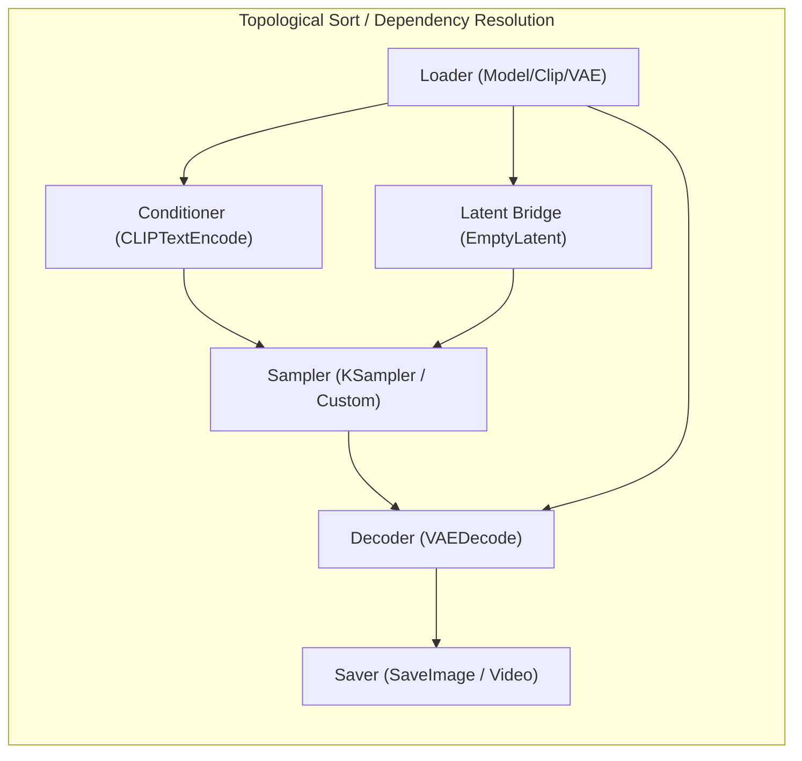
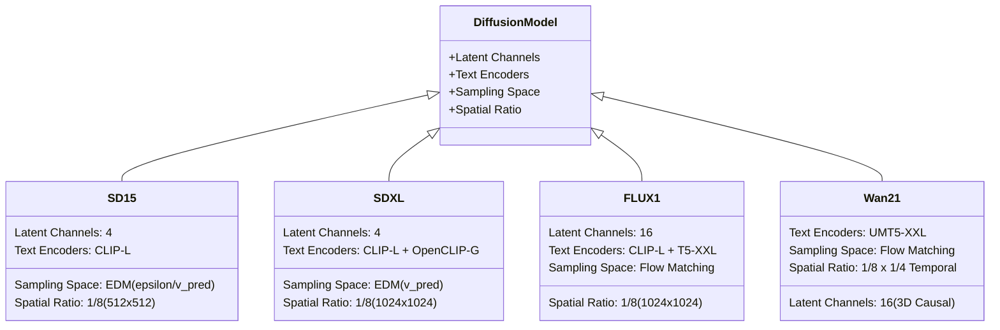
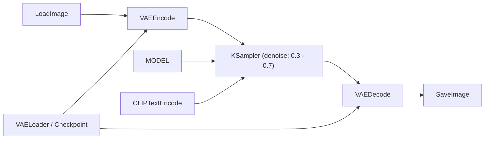
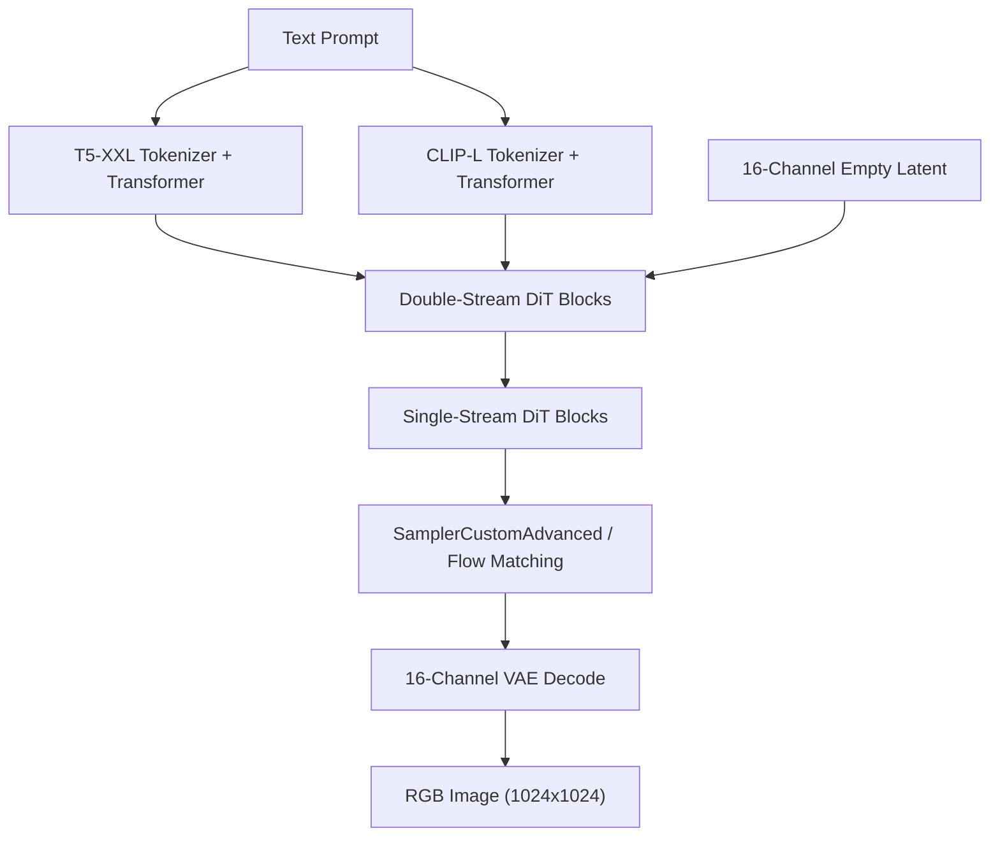
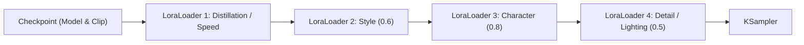
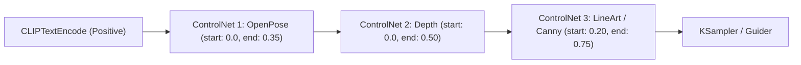
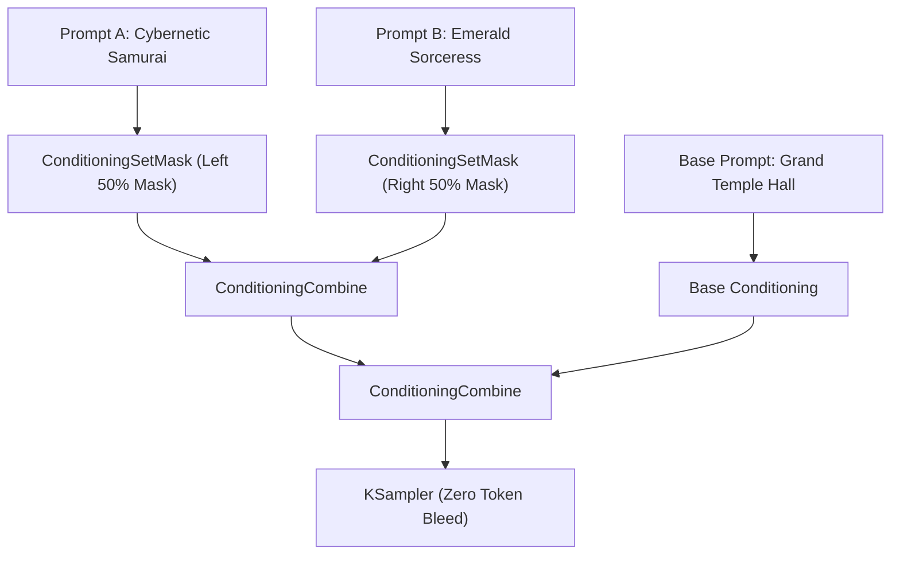
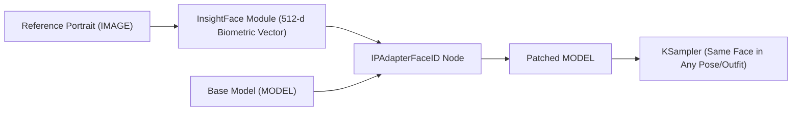
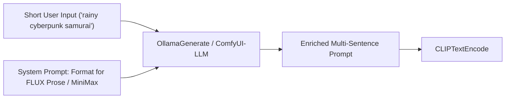
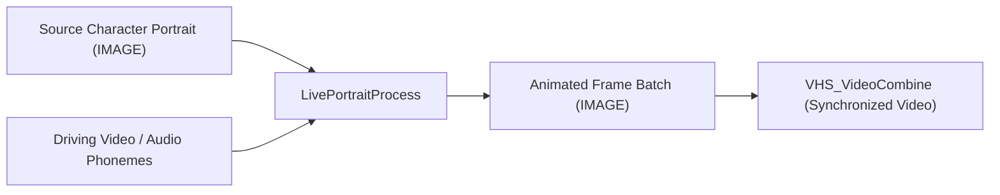

# ComfyUI Neuro-Symbolic Curriculum & Knowledge Engine
### *A Formal Technical Manual & Instruction Framework for Local Large Language Models*

---

## Pedagogical Abstract & Instructional Objectives

This document is an exhaustive instructional curriculum and foundational reference manual designed specifically for **Local Large Language Models (LLMs)** (such as Llama 3, Qwen 2.5, DeepSeek, Mistral). 

Human learners grasp ComfyUI visually through colored dragging wires and canvas UI layouts. However, LLMs must understand ComfyUI as a **strongly typed, declarative Directed Acyclic Graph (DAG)** of tensor-transforming operations. When an LLM understands the underlying mathematical representations, strict type contracts, latent space geometries, prompt token mechanics, and the native API JSON schema, it can accurately compose, debug, convert, and reason over workflows without hallucinations.

### Target Competencies for the LLM
1. **Structural Mastery**: Distinguish between UI Workflow Graph JSON (`workflow.json`) and the Execution Prompt Graph JSON (`prompt.json`), always generating compliant execution graphs.
2. **Type Contract Enforcement**: Maintain zero-error type safety across ports (`MODEL`, `CLIP`, `VAE`, `LATENT`, `CONDITIONING`, `IMAGE`, `MASK`, `CONTROL_NET`, `GUIDER`, `SAMPLER`, `SIGMAS`, `SAM2_MODEL`, `MESH`).
3. **Architectural Disambiguation**: Differentiate image models (SD 1.5, SDXL, SD 3.5, FLUX.1 ecosystem) and video/omni models (SVD, AnimateDiff, Wan 2.1, LTX 2.3, MiniMax H3) in latent channel dimensions, text encoder bindings, audio sync, and guidance mechanics.
4. **Prompting Structure & Language Routing**: Match prompt style to the text encoder architecture (tag-based weighted tokens for CLIP-L vs. dense descriptive prose for T5-XXL / UMT5; kinetic camera verbs for video; chronological multishot and acoustic prompting for omni-modal engines).
5. **Specialized Vision & Spatial Tasks**: Master workflows for Image-to-Image (I2I), Inpainting/Outpainting, AI-assisted masking (SAM/SAM2), subject relighting (IC-Light), temporal reference propagation (Ref-to-Video), and native 3D mesh synthesis (Trellis.2).
6. **Modular Weight Patching & LoRA Engineering**: Understand low-rank mathematical adaptation ($W_0 + \frac{\alpha}{r}BA$), tune independent model vs. CLIP multipliers, prevent cross-adapter interference, and chain multi-LoRA stacks for character identity, aesthetic styles, and acceleration.
7. **Production Upscaling & Spatial Conditioning**: Construct two-pass Hi-Res Fix pipelines (`UpscaleImageWithModel` + `VAEDecodeTiled`), choreograph multi-ControlNet schedules (`start_percent`/`end_percent`), and enforce regional conditioning (`ConditioningSetArea`) to eliminate multi-character token bleed.
8. **Quantization & Advanced Feature Steering**: Deploy memory-efficient GGUF/FP8 DiTs on consumer hardware, modulate backbone features via `FreeU_V2` and PAG, and execute zero-shot facial identity preservation via `IPAdapterFaceID`.

---

## Module 1: The ComfyUI Execution Model & Graph Grammar

### 1.1 The DAG Computation Engine
ComfyUI is a Python-based node execution engine built on PyTorch. Workflows are represented internally as **Directed Acyclic Graphs (DAGs)**.



- **Execution Direction**: Execution is requested by sending a target graph to the `/prompt` HTTP endpoint. The server traverses backwards from nodes marked as `OUTPUT_NODE = True` (e.g., `SaveImage`, `PreviewImage`, `VHS_VideoCombine`, `Save 3D`) to build a topological execution tree.
- **Lazy Evaluation & Caching**: Nodes are cached by hashing their class type, inputs, and incoming connections. If inputs have not mutated, ComfyUI reuses output tensors in memory, skipping expensive recalculations.
- **Dynamic Patcher (`ModelPatcher`)**: Rather than cloning entire multi-gigabyte models, ComfyUI applies LoRA weights, control nets, model sampling modifications, IC-Light UNet injections, and IC-LoRAs via non-destructive in-memory weight patches.

---

### 1.2 Two Distinct JSON Formats (Critical LLM Distinction)

LLMs frequently fail because they confuse ComfyUI's **UI Graph Schema** with its **API Execution Prompt Schema**.

```
+---------------------------------------------------------------------------------------+
| UI Graph Schema (.json / "Save")                                                      |
| - Used solely by the web browser frontend (LiteGraph.js).                             |
| - Contains node coordinates [x, y], wire connection IDs, UI zoom levels, colors.     |
| - Useless and invalid for direct backend execution.                                   |
+---------------------------------------------------------------------------------------+
                                        vs
+---------------------------------------------------------------------------------------+
| API Prompt Schema (.json / "Save (API Format)")                                       |
| - Sent to POST /prompt. Contains ONLY functional execution instructions.              |
| - Flat dictionary where keys are stringified Node IDs.                                 |
| - Each object contains "class_type" and "inputs".                                      |
+---------------------------------------------------------------------------------------+
```

#### The API Prompt JSON Grammar:
```json
{
  "<node_id_string>": {
    "class_type": "<ExactComfyUIClassString>",
    "inputs": {
      "<widget_or_slot_name>": "<primitive_value_or_link_tuple>"
    }
  }
}
```

#### Link Tuple Invariant:
When an input port receives data from another node, it is formatted strictly as a 2-element array:
$$\text{Link} = [\text{source\_node\_id: str}, \text{output\_slot\_index: int}]$$

*Example*: If Node `"3"` needs the `MODEL` output from `CheckpointLoaderSimple` (which is slot `0` of Node `"4"`), the input is:
```json
"model": ["4", 0]
```

---

## Module 2: The Strong Type System & Connection Contracts

ComfyUI strictly validates port compatibility. Output type $T_{out}$ must match input type $T_{in}$.

### 2.1 The Core Type Registry

| Type Identifier | Underlying PyTorch Data Structure | Geometric Shape / Tensor Specification | Semantic Purpose |
| :--- | :--- | :--- | :--- |
| **`MODEL`** | `comfy.model_patcher.ModelPatcher` | Object holding base UNet / DiT weights & patches | The core denoising neural network backbone. |
| **`CLIP`** | `comfy.sd.CLIP` | Text Tokenizer(s) + Text Transformer(s) | Encodes string prompts into embedding spaces. |
| **`VAE`** | `comfy.sd.VAE` | AutoencoderKL / 3D Causal Autoencoder | Translates between pixel space (`IMAGE`) and latent space (`LATENT`). |
| **`LATENT`** | Python `dict` with key `"samples"` | `{"samples": torch.Tensor}`<br>Image: `[B, C, H//8, W//8]`<br>Video: `[B, C, T, H//8, W//8]` | Compressed feature representation where denoising occurs. |
| **`CONDITIONING`** | Python `list` of `[tensor, dict]` | `[[torch.Tensor(B, Tokens, Dim), {"pooled_output": torch.Tensor}]]` | Cross-attention and pooled embeddings steering the generation. |
| **`IMAGE`** | `torch.Tensor` (float32) | `[B, H, W, C]` (Range: `0.0` to `1.0`, RGB) | Pixel-space visual data. Note channel-last format! |
| **`MASK`** | `torch.Tensor` (float32) | `[B, H, W]` (Range: `0.0` to `1.0`, 1=masked/generate, 0=preserve) | Alpha/spatial weight mask for inpainting or compositing. |
| **`CONTROL_NET`** | `comfy.controlnet.ControlNet` | Neural network module applied to intermediate UNet/DiT blocks | Spatial structural guidance (depth, pose, canny). |
| **`SAM2_MODEL`** | Meta SAM2 Model instance | Vision Transformer + Memory Bank container | High-precision zero-shot point/box mask segmenter. |
| **`MESH`** | `trimesh.Trimesh` / Native 3D Tensor | Vertices `[V, 3]`, Faces `[F, 3]`, Normals `[V, 3]`, UVs | Geometric surface representation for 3D rendering. |
| **`GUIDER`** | `comfy.samplers.CFGGuider` / `BasicGuider` | Callable wrapper binding Model + Conditioning + CFG logic | Determines how the model calculates velocity/noise vectors. |
| **`SAMPLER`** | `comfy.samplers.KSampler` | Algorithm pointer (e.g., `euler`, `dpmpp_2m_sde`) | The numerical ODE/SDE solver engine. |
| **`SIGMAS`** | `torch.Tensor` | 1D sequence of float noise levels: `[sigma_max, ..., sigma_0 = 0.0]` | The noise step trajectory calculated by a scheduler. |
| **`NOISE`** | `comfy.k_diffusion.noise.Noise` | Generator / Seed container | Supplies pseudo-random Gaussian noise for sampling. |

---

### 2.2 Connection Compatibility Rules

```
[MODEL] --------> [model: KSampler] | [model: BasicGuider] | [model: LoraLoader] | [model: LoadAndApplyICLightUnet]
[CLIP] ---------> [clip: CLIPTextEncode] | [clip: DualCLIPLoader] | [clip: LoraLoader]
[VAE] ----------> [vae: VAEDecode] | [vae: VAEEncode] | [vae: VAEEncodeForInpaint]
[LATENT] -------> [latent_image: KSampler] | [samples: VAEDecode] | [samples: LatentUpscale]
[CONDITIONING] -> [positive / negative: KSampler] | [conditioning: BasicGuider] | [conditioning: ICLightConditioning]
[IMAGE] --------> [pixels: VAEEncode] | [images: SaveImage] | [image: ControlNetApply] | [image: Sam2Segmentation] | [image: Trellis2ShapeStage]
[MASK] ---------> [mask: VAEEncodeForInpaint] | [mask: LatentCompositeMasked] | [mask: SetLatentNoiseMask]
[MESH] ---------> [mesh: Remesh Mesh] | [mesh: Decimate Mesh] | [mesh: Preview 3D] | [mesh: Save 3D]
```

> [!CAUTION]
> **TENSOR SHAPE INVARIANT**: An `IMAGE` in ComfyUI is **channel-last**: `[Batch, Height, Width, Channels]`. It is NOT standard PyTorch `[Batch, Channels, Height, Width]`. Feeding PyTorch standard images directly into ComfyUI nodes will corrupt spatial dimensions.

---

## Module 3: Foundational Model Architectures (Image & Video)

An LLM must understand what weights are inside a model file and how their latent spaces differ.



### 3.1 Image Foundation Models

#### 1. Stable Diffusion 1.5 (SD 1.5)
- **Backbone**: 2D UNet (~860M params).
- **Text Encoder**: Single OpenAI `CLIP ViT-L/14` (Max tokens: 77, dimension: 768).
- **VAE**: 4-channel latent space ($C=4$), spatial compression factor $8\times$ ($512 \times 512 \rightarrow 64 \times 64$).
- **Latent Shape**: `[B, 4, H//8, W//8]`. Optimal Resolution: $512 \times 512$.

#### 2. Stable Diffusion XL (SDXL)
- **Backbone**: Larger 2D UNet (~2.6B params).
- **Text Encoders**: Dual encoders:
  - `clip_l`: OpenAI CLIP ViT-L/14.
  - `clip_g`: OpenCLIP ViT-bigG/14 (dimension: 1280).
- **Micro-Conditioning**: Encodes original image dimensions, target dimensions, and crop coordinates into pooled text embeddings.
- **VAE**: 4-channel latent space ($C=4$), custom SDXL VAE trained with higher precision. Optimal Resolution: $1024 \times 1024$.

#### 3. Stable Diffusion 3 / 3.5 (SD3 / SD3.5)
- **Backbone**: Multimodal Diffusion Transformer (MMDiT), separating image and text processing streams before merging in attention.
- **Text Encoders**: Triple encoders (`clip_l`, `clip_g`, and `t5xxl`).
- **VAE**: 16-channel latent space ($C=16$), spatial compression factor $8\times$.
- **Formulation**: Rectified Flow Matching rather than discrete noise diffusion.

#### 4. FLUX.1 ([schnell] & [dev])
- **Backbone**: 12B parameter Flow Transformer combining Double-Stream DiT blocks and Single-Stream DiT blocks.
- **Text Encoders**: Dual encoders:
  - `clip_l`: OpenAI CLIP ViT-L/14 (aesthetic/style bias).
  - `t5xxl`: Google T5-v1.1-XXL (complex spatial relations, typography, scene composition).
- **VAE**: 16-channel latent space ($C=16$), compression factor $8\times$ (latent shape: `[B, 16, H//8, W//8]`).
- **Guidance & CFG**:
  - `FLUX.1-schnell`: Distilled 4-step model. **Must use CFG = 1.0**. Negative prompt is mathematically inert.
  - `FLUX.1-dev`: Guidance-distilled model. Does NOT use classic CFG. Uses a `FluxGuidance` node feeding into a `BasicGuider` (standard guidance value: `3.5`).

---

### 3.2 Video Foundation Models

| Model Family | Core Backbone | Latent Dimensions | Temporal Mechanism | Key Conditioning Inputs |
| :--- | :--- | :--- | :--- | :--- |
| **SVD / SVD-XT** | 2D+1D Temporal UNet | `[B, 4, Frames, H//8, W//8]` | Temporal self-attention & cross-attention | Initial conditioning image, `motion_bucket_id` (1–255), `fps`, `augmentation_level` |
| **AnimateDiff** | SD 1.5 or SDXL UNet + Motion Module | `[B, 4, Frames, H//8, W//8]` | Injected temporal cross-attention layers across latent frame batches | Context windows (sliding stride), motion scale, LoRA motion modules |
| **Wan 2.1** (T2V & I2V) | 3D DiT (14B or 1.3B) | `[B, 16, (Frames-1)//4 + 1, H//8, W//8]` | 3D Causal spatio-temporal VAE | UMT5 text embeddings, input latent frames, flow matching schedulers |
| **LTX-Video (LTX 2.3)** | Real-Time DiT (~2B) | `[B, 128, T_lat, H//32, W//32]` | Unified Video-VAE spatio-temporal patchifier | Gemma / T5 text, native audio sync, IC-LoRA guides |
| **MiniMax H3 (Hailuo)** | Omni-Modal DiT | `[B, 16, T_lat, H//8, W//8]` | Full 3D Spatio-Temporal attention | Qwen text encoder, synchronized stereo audio, multishot chronological prompts |
| **HunyuanVideo** | Dual-Stream to Single-Stream DiT (13B) | `[B, 16, T_lat, H//8, W//8]` | Full 3D Spatio-Temporal attention | MLLM / Text encoder embeddings, causal 3D VAE |
| **CogVideoX** | 3D Expert DiT | `[B, 16, T_lat, H//8, W//8]` | 3D Rotational Position Embeddings (RoPE) | T5-XXL text encoder, 3D VAE decode |

---

## Module 4: The 6 Functional Node Classes

```
[1. Loaders] ---> [2. Conditioners] ---> [4. Samplers] <--- [3. Latent Bridges]
     |                                        |
     +---------------------------------> [5. Decoders] ---> [6. Savers]
```

### 4.1 Class 1: Loaders
Extracts weights from disk and allocates GPU/CPU memory structures.
* `CheckpointLoaderSimple`: Loads all-in-one checkpoint $\rightarrow$ `(MODEL, CLIP, VAE)`.
* `UNETLoader`: Loads isolated DiT/UNet weights $\rightarrow$ `MODEL`.
* `DualCLIPLoader`: Combines two standalone encoders (e.g., T5-XXL + CLIP-L) $\rightarrow$ `CLIP`.
* `VAELoader`: Loads dedicated autoencoders $\rightarrow$ `VAE`.
* `LoraLoader`: Non-destructive dynamic weight patcher $\rightarrow$ patches `MODEL` and `CLIP`.
* `ControlNetLoader`: Loads dedicated structural guidance networks $\rightarrow$ `CONTROL_NET`.

### 4.2 Class 2: Conditioners
Transforms prompts, bounding coordinates, and reference signals into conditioning dictionaries.
* `CLIPTextEncode`: Tokenizes text and produces hidden state vectors $\rightarrow$ `CONDITIONING`.
* `FluxGuidance`: Tags conditioning tensors with guidance float scale $\rightarrow$ `CONDITIONING`.
* `ControlNetApplyAdvanced`: Computes spatial structural bias $\rightarrow$ `CONDITIONING`.
* `InpaintModelConditioning`: Injects masked visual latent representations directly into conditioning.

### 4.3 Class 3: Latent Space Bridges
Manages tensor allocation, resolution geometry, and pixel-to-latent conversions.
* `EmptyLatentImage`: Allocates 4-channel tensor dictionary `[B, 4, H//8, W//8]`.
* `EmptySD3LatentImage`: Allocates 16-channel tensor dictionary `[B, 16, H//8, W//8]`.
* `VAEEncode`: Encodes `IMAGE` to `LATENT` for Image-to-Image (I2I).
* `VAEEncodeForInpaint`: Encodes image with masked boundaries and padding $\rightarrow$ `LATENT`.
* `LatentUpscaleBy`: Mathematically resamples latent matrices via bicubic interpolation.
* `LatentCompositeMasked`: Blends source and target latents using a `MASK`.

### 4.4 Class 4: Samplers
Executes numerical noise subtraction across scheduled timesteps (see Module 5).

### 4.5 Class 5: Decoders
Translates compressed latent representations back to viewable RGB pixels.
* `VAEDecode`: Full-frame VAE decoding $\rightarrow$ `IMAGE`.
* `VAEDecodeTiled`: Splits massive latent tensors into spatial tiles with overlapping seams, preventing VRAM overflow.

### 4.6 Class 6: Savers
Terminal execution triggers (`OUTPUT_NODE = True`).
* `SaveImage`: Writes PNG files with embedded execution graph metadata.
* `PreviewImage`: Displays temporary images directly on canvas.
* `VHS_VideoCombine`: Takes batched image frames, encodes with FFmpeg, and writes MP4/WebM video.
* `Save 3D`: Exports 3D models to `.glb`, `.obj`, `.ply`, or Gaussian splat formats.

---

## Module 5: Sampling Demystified: Monolithic vs. Modular

### 5.1 The Monolithic `KSampler`
Encapsulates seed, noise curve, prompt guidance, and numerical steps into one block:
* `denoise = 1.0`: Pure Text-to-Image (100% replacement with random noise).
* `denoise < 1.0`: Image-to-Image or latent refinement (preserves base latent structure).
* `cfg`: Classifier-Free Guidance scale ($\hat{\epsilon} = \epsilon_{\text{uncond}} + \text{cfg} \cdot (\epsilon_{\text{cond}} - \epsilon_{\text{uncond}})$).

### 5.2 The Modular Custom Sampler Framework
Modern architectures (FLUX, SD3, Wan, LTX) replace the monolithic sampler with four modular nodes:

```
[RandomNoise] ---------------> [noise]
[BasicGuider / CFGGuider] ---> [guider]   ===> [SamplerCustomAdvanced] ===> [output: LATENT]
[KSamplerSelect] ------------> [sampler]
[BasicScheduler] ------------> [sigmas]
[EmptyLatentImage] ----------> [latent_image]
```

* `BasicGuider`: Runs guidance without a negative prompt pass (mandatory for FLUX Schnell / Dev).
* `CFGGuider`: Runs classic dual-pass guidance with negative conditioning.
* `KSamplerSelect`: Picks the integration solver (`euler`, `dpmpp_2m`, `heun`).
* `BasicScheduler`: Computes the noise variance curve (`normal`, `karras`, `simple`, `beta`).

---

## Module 6: Prompt Engineering Grammar for Local LLMs (Image & Video)

LLMs must understand that prompt syntax is tightly coupled to the underlying **Text Encoder Architecture**.

```
┌────────────────────────────────────────────────────────────────────────────────────────┐
│                              PROMPT SYNTAX COMPATIBILITY MATRIX                        │
├─────────────────────┬──────────────────┬──────────────────┬────────────────────────────┤
│ Model Family        │ Primary Encoder  │ Syntax Style     │ Token Rules                │
├─────────────────────┼──────────────────┼──────────────────┼────────────────────────────┤
│ SD 1.5              │ CLIP-L (77 tok)  │ Booru / Tag-list │ `(tag:1.2)`, commas, short │
│ SDXL                │ CLIP-L + CLIP-G  │ Hybrid (Tags+Nat)│ Main subject + Style tags  │
│ SD 3.5 / FLUX.1     │ T5-XXL + CLIP-L  │ Natural Prose    │ Dense descriptive sentences│
│ Wan 2.1 / CogVideo  │ UMT5-XXL / T5    │ Kinetic Narrative│ Camera motion + Action     │
│ LTX-Video 2.3       │ Gemma / T5-XXL   │ Real-time Action │ Velocity, lighting, audio  │
│ MiniMax H3 (Hailuo) │ Qwen-based       │ Omni Multishot   │ 4,000–6,000 char modular   │
└─────────────────────┴──────────────────┴──────────────────┴────────────────────────────┘
```

### 6.1 Image Prompting Grammar

#### Tag-Based Encoders (SD 1.5, SDXL):
* **Grammar**: Comma-separated descriptors with explicit weighting syntax:
  ```text
  1girl, solo, cinematic lighting, (photorealistic:1.2), masterpiece, 8k resolution, Tokyo street, rainy night, neon reflections
  ```
* **Negative Prompting**: Mandatory. Must explicitly list artifacts: `ugly, deformed, lowres, bad anatomy, text, watermark`.

#### Natural Language Transformer Encoders (FLUX.1, SD 3.5):
* **Grammar**: Dense, complete prose specifying spatial layout, lighting direction, texture details, and exact typography in quotation marks:
  ```text
  A medium close-up photograph of a weathered astronaut standing on the terracotta dunes of Mars during sunset. The golden hour light casts long shadows across the textured regolith. The astronaut holds a faded photograph of Earth. On their chest plate, the word "VOYAGER" is sharply stenciled in matte white capital letters.
  ```
* **Negative Prompting**: **Inert in FLUX.1**. The LLM should not waste tokens or compute on negative prompts for FLUX.

---

### 6.2 Video Prompting Grammar & Temporal Physics

Video diffusion models (Wan 2.1, LTX 2.3, MiniMax H3, SVD) require **temporal motion instructions**. Static descriptions result in frozen or morphing frames.

#### The 4-Part Video Prompt Formula:
1. **Camera Direction & Movement**: Establish camera kinetics (`Slow pan left`, `Static tripod shot`, `Dynamic forward dolly tracking shot`, `Crane down from high angle`).
2. **Subject Kinetic Action**: Use continuous, progressive action verbs (`A majestic eagle gracefully spreads its wings and launches into flight`, NOT `An eagle flying`).
3. **Environmental Motion**: Include background kinetics to maintain temporal coherence across frames (`Autumn leaves flutter through the air`, `Water ripples across the lake surface`, `Steam rises from the sewer grate`).
4. **Temporal Progression**: Describe how the scene evolves from the first frame to the last frame (`Over the course of 3 seconds, the camera accelerates as the car turns the corner`).

---

## Module 7: Image-to-Image (I2I) Workflow Design

In an Image-to-Image workflow, an existing image is compressed into latent space, partially perturbed with Gaussian noise according to the **denoise** parameter, and resampled.



### Key Parameters & Principles for I2I:
1. **`VAEEncode`**: Converts `IMAGE` $\rightarrow$ `LATENT`.
2. **`denoise` Scale Selection**:
   * `0.10 - 0.30`: Subtle touch-ups, color grading, noise reduction.
   * `0.35 - 0.55`: Style transfer (e.g., photo to digital painting) while locking anatomy and composition.
   * `0.60 - 0.80`: Heavy creative re-imagining. Retains rough geometry, alters fine details.
   * `1.00`: Completely replaces input image with random noise (destroys original image).
3. **Resolution Alignment**: Input image should be scaled to native model multiples (e.g., $1024 \times 1024$ for SDXL/FLUX) to avoid distortion.

---

## Module 8: Inpainting & Outpainting Engineering

### 8.1 Inpainting Pipeline
Inpainting regenerates a targeted portion of an image defined by a `MASK` while keeping the unmasked pixels bit-for-bit identical.

* **`VAEEncodeForInpaint`**:
  * Inputs: `pixels` (`IMAGE`), `vae` (`VAE`), `mask` (`MASK`), `grow_mask_by` (`INT`, default `6`).
  * Expands mask boundaries slightly into surrounding unmasked pixels to calculate smooth blend seams.
* **`InpaintModelConditioning`** (For Inpainting-specific checkpoints like `sd_xl_inpaint.safetensors`):
  * Concatenates masked image channels directly into conditioning tensors.
* **`SetLatentNoiseMask`**:
  * Applies a mask directly to an existing `LATENT` tensor, instructing the sampler to calculate noise updates only inside white mask regions ($1.0$).

### 8.2 Outpainting Pipeline
Outpainting expands canvas boundaries outward to extend the scene:
1. **`PadImageForOutpaint`**:
   * *Inputs*: `image` (`IMAGE`), `left` (`INT`), `top` (`INT`), `right` (`INT`), `bottom` (`INT`), `feathering` (`INT`, default `40`).
   * *Outputs*: Padded `IMAGE` and corresponding boundary `MASK`.
2. Routed into `VAEEncodeForInpaint` and sampled with `denoise = 1.0`.

---

## Module 9: Segment Anything (SAM, SAM 2, SAM 3) in ComfyUI

Meta's Segment Anything models (integrated via `ComfyUI-segment-anything-2` by Kijai) provide zero-shot spatial mask generation driven by text, bounding boxes, or click coordinates.

* **`(Down)Load SAM2Model`**: Loads the vision transformer and memory bank (`hiera_large`, `hiera_base_plus`). The `segmentor` parameter must match downstream use: `single_image` for photos or `video` for tracking across frames.
* **`Sam2Segmentation`**: Computes binary `MASK` and RGBA cutout `IMAGE` from bounding box coordinates or click points.
* **Autonomous Text Masking**: Often paired with `Florence2Run` or `GroundingDino` to convert natural language queries ("the red car") into bounding boxes for `Sam2Segmentation`.
* **`Sam2VideoSegmentation`**: Propagates object masks across sequential video frame batches using SAM 2's temporal memory bank.

---

## Module 10: Relighting Architectures: IC-Light (Imposing Consistent Light)

Created by Lvmin Zhang (ControlNet creator) and integrated via `ComfyUI-IC-Light`:
* **`iclight_sd15_fc.safetensors` (Foreground Conditioned)**: Relights an isolated subject using pure text conditioning (e.g., *"dramatic warm rim lighting from the left"*).
* **`iclight_sd15_fbc.safetensors` (Foreground + Background Conditioned)**: Takes both a subject and a background image, matching specular reflections, color temperature, and contact shadows from the background onto the subject.
* **`LoadAndApplyICLightUnet`**: Patches the UNet's input channels (expanding from 4 to 8 or 12 channels) to accept concatenated conditioning images.

---

## Module 11: Image-to-Video (I2V) & Reference-to-Video (Ref-to-Video)

* **Image-to-Video (I2V)**:
  * **SVD**: Uses `SVD_img2vid_Conditioning` with `motion_bucket_id` (`1–255`), `fps`, and `augmentation_level`.
  * **Wan 2.1 I2V**: Uses a 3D Causal VAE to compress the input image into initial latent frames, concatenated with empty future frame latents ($17, 33, \text{or } 81$ frames).
* **Reference-to-Video (Ref-to-Video)**:
  * Maintains character appearance across motion without retraining using **IP-Adapter (`IPAdapterApply`)**, extracting visual features via `CLIP-Vision` (e.g., `SigLIP`) and injecting them into cross-attention layers of AnimateDiff or Wan 2.1.
  * Motion driving models (LivePortrait / MimicMotion) transfer facial or body kinetics from a guide video while preserving the reference subject identity.

---

## Module 12: Next-Gen Foundation Models: In-Depth Architecture & Prompting

### 12.1 The FLUX.1 Ecosystem Mastery

Black Forest Labs' FLUX.1 is a 12B parameter flow matching transformer that represents the state of the art in open-weights image generation.



#### FLUX Architectural Mechanics:
1. **Double-Stream Blocks**: Processes image latent patches and text tokens through independent projection layers before performing joint bidirectional attention.
2. **Single-Stream Blocks**: Concatenates visual tokens and text tokens into a single unified sequence, passing them through shared self-attention and MLP layers.
3. **16-Channel VAE**: Provides significantly higher spatial and color fidelity than legacy 4-channel VAEs.
4. **Rotational Position Embeddings (RoPE)**: Provides 2D coordinate-aware positional awareness, enabling accurate spatial composition and crisp typography.

#### FLUX Model Flavors in ComfyUI:
* **`FLUX.1-schnell`**: 4-step distilled model. **Must use CFG = 1.0**. Negative prompt has NO effect. Uses `euler` sampler with `simple` scheduler.
* **`FLUX.1-dev`**: 20–28 step guidance-distilled model. Does not use classic CFG. Uses a `FluxGuidance` node feeding into a `BasicGuider` (standard guidance value: `3.5`).
* **`FLUX.1-Fill`**: Specialized inpainting model. Expects concatenated masked image channels ($16 \text{ latent channels} + 16 \text{ masked latent channels} + 1 \text{ mask channel} = 33 \text{ channels}$). Uses `FluxFillUnetLoader` with `flux1-fill.safetensors`.
* **`FLUX.1-Redux`**: Image-to-image and style variation model. Uses SigLIP visual embeddings passed via `StyleModelLoader` and `ApplyStyleModel` to adapt image features directly into FLUX's attention stream.
* **`FLUX.1-Depth` & `FLUX.1-Canny`**: Native structural guidance models that take depth or edge maps directly without needing external ControlNet weights.

#### FLUX Prompting Engineering Guidelines:
* **Natural Prose Syntax**: Structure prompts as full grammatical paragraphs describing subject, lighting, environment, and framing.
* **Exact Typography Syntax**: Enclose desired text in double quotes: `"OPEN 24 HOURS"`.
* **Spatial Relationship Directives**: Explicitly describe layout: `to the left of the oak table`, `partially obscured in the background`.

---

### 12.2 Lightricks LTX-Video & LTX 2.3 Architecture & Prompting

LTX-Video (developed by Lightricks) is a high-speed, transformer-based latent diffusion video foundation model optimized for real-time and near real-time generation.

#### LTX Architectural Mechanics:
1. **High Compression Video-VAE**: Compresses spatio-temporal video data by a factor of $32\times$ spatially and temporally, enabling ultra-fast sampling of long video sequences.
2. **Diffusion Transformer (DiT)**: Employs full causal attention across 3D spatio-temporal tokens.
3. **Multimodal Synchronization (LTX 2.3)**: Generates synchronized video and audio tokens natively or guides them via cross-modal attention.

#### Core ComfyUI Nodes (`ComfyUI-LTXVideo`):
* `LTXVModelLoader`: Loads the base LTX-Video checkpoint (e.g., `ltx-video-2b-v0.9.safetensors` or LTX 2.3).
* `GemmaAPITextEncode` / `LTXVLoadConditioning`: Memory-optimized text encoding using Gemma or T5 text transformers.
* `MultimodalGuider`: Manages independent audio and video guidance scales during denoising.
* `LTXVNormalizingSampler`: Special sampling solver designed to prevent overbaking, contrast clipping, and audio distortion.
* `LTX Add Video IC-LoRA Guide Advanced`: Injects in-context LoRAs for spatial trajectory and camera path control.
* `LTXVSDRToHDRWorkingSpace`: Color pipeline node enabling native High Dynamic Range (HDR) video export.

#### LTX Video Prompting Grammar:
* **Motion Velocity Cues**: Specify exact movement speed (`fast camera tracking`, `slow gentle drift`, `sudden acceleration`).
* **Lighting Dynamics**: Detail illumination changes across frames (`shadows lengthen as the sun sets`, `strobe flashes illuminate the dancer`).
* **Acoustic Descriptions**: When utilizing audio-enabled checkpoints, specify environmental acoustics: `engine roar echoes through the canyon`, `subtle rustle of autumn leaves`.

---

### 12.3 MiniMax H3 (Hailuo AI) Omni-Modal Video Architecture & Prompting

MiniMax H3 is a large-scale omni-modal generative video model created by Hailuo AI, natively supporting text-to-video, image-to-video, and reference-to-video with synchronized stereo audio.

#### MiniMax H3 Architectural Mechanics:
1. **Joint Audio-Visual DiT**: Denoises both video frame latents and stereo audio spectrograms in a single unified diffusion pass, guaranteeing synchronization between lip movements, action kinetics, and sound effects.
2. **Qwen-Based Text Encoder**: Employs advanced multilingual LLM reasoning to comprehend complex cinematic scripts, multishot scene progression, and nuanced physics.
3. **Keyframe Conditioning**: Supports first-frame, last-frame, and multi-reference conditioning to enforce continuity across extended cinematic sequences.

#### The 4,000–6,000 Character Cinematic Standard:
MiniMax H3 responds best to detailed, structured cinematic descriptions organized into a **4-part modular format**:

$$\text{Prompt Block} = \text{[Camera Movement]} + \text{[Subject Performance]} + \text{[Lighting \& Environment]} + \text{[Audio Soundscape]}$$

#### Multishot Prompting Syntax:
For complex sequences, format the prompt chronologically using shot markers:
```text
[Shot 1]: A wide establishing crane shot descending toward a rainy Tokyo intersection at night. Neon signs reflect across wet asphalt. A young woman in a yellow trench coat opens a transparent umbrella. Audio: Heavy rain pouring against pavement, distant muffled siren, soft click as umbrella opens.
[Shot 2]: Smooth cut to a medium close-up tracking shot walking in front of the woman. She looks directly into the lens with a calm expression. Raindrops bead and slide down the clear plastic umbrella. Audio: Clear footsteps splashing in puddles, ambient city chatter, gentle exhale.
```

---

### 12.4 Native 3D Generative Rendering in ComfyUI (Trellis.2 & Pixal3D)

Integrated natively into ComfyUI core (August 2026), ComfyUI now features a full, dependency-free 3D mesh generation and post-processing pipeline implemented entirely in PyTorch and SciPy—eliminating the need for custom C++ build tools or external packages like `nvdiffrast`.


#### The Two-Stage 3D Pipeline:
1. **`Trellis2ShapeStage`**:
   * Takes a single 2D image (ideally pre-segmented via SAM2 or background-removal nodes).
   * Generates a 3D Structured Latent Representation defining volumetric geometry and signed distance fields.
2. **`Trellis2TextureStage`**:
   * Projects high-resolution textures, normal maps, and vertex colors onto the synthesized geometric mesh.

#### Native Mesh Post-Processing Nodes:
* **`Remesh Mesh`**: Retopologizes messy AI-generated triangle soups into clean, uniform vertex distributions.
* **`Decimate Mesh`**: Reduces polygon count to specified thresholds (e.g., reducing 500,000 polys to 25,000 polys for real-time game engines).
* **`Smooth Mesh Normals`**: Calculates vertex normal vectors to eliminate harsh polygonal creases.
* **`Fill Holes`**: Mathematically seals non-manifold geometry and mesh boundary perforations.
* **`Preview 3D` & `Save 3D`**: Interactive WebGL viewport and file exporter supporting `.glb`, `.obj`, `.ply`, and Gaussian Splat formats.

#### Image Prompting & Pre-Processing for 3D Generation:
* **Neutral Background Invariant**: The input image must have an isolated subject on a solid white, black, or transparent background. Pair with `Sam2Segmentation` or `RMBG`.
* **Perspective Guidelines**: Avoid wide-angle fish-eye lenses, severe perspective tilt, or extreme occlusions. Orthographic or mild telephoto angles ($50\text{mm}–85\text{mm}$ equivalent) produce the highest geometric fidelity.

---

## Module 13: LoRA Engineering: Mathematics, Weight Mechanics & Modular Stacking

Low-Rank Adaptation (LoRA) is the standard technique for parameter-efficient fine-tuning and modular conditioning in ComfyUI. Rather than updating all parameters of a multi-billion-parameter foundation model, LoRA freezes the original weights and injects trainable rank-decomposition matrices.

### 13.1 Mathematical Mechanics of LoRA
For a pre-trained weight matrix $W_0 \in \mathbb{R}^{d \times k}$ (such as an attention projection matrix $W_q, W_k, W_v, W_o$ or MLP linear layer), LoRA decomposes the weight update $\Delta W$ into the product of two low-rank matrices:

$$W = W_0 + \Delta W = W_0 + \frac{\alpha}{r} (B \cdot A)$$

Where:
* $B \in \mathbb{R}^{d \times r}$ (initialized to zeros)
* $A \in \mathbb{R}^{r \times k}$ (initialized with Gaussian noise)
* $r \ll \min(d, k)$ is the **Rank** (typically $r \in [4, 8, 16, 32, 64]$)
* $\alpha$ is a constant scaling hyperparameter (**Alpha**)
* $\frac{\alpha}{r}$ is the fixed scaling factor

#### ComfyUI In-Memory Patching (`ModelPatcher`):
In ComfyUI, loading a LoRA does NOT alter the model file on disk or create a full weight duplicate in VRAM. The `ModelPatcher` stores the low-rank delta matrices in memory and dynamically intercepts forward-pass calculations:
$$\text{Output} = x \cdot W_0^T + \text{strength\_model} \cdot \left(\frac{\alpha}{r} \cdot x \cdot A^T \cdot B^T\right)$$
This non-destructive execution allows swapping and stacking multiple LoRAs without reloading the base checkpoint.

---

### 13.2 Parameter Mechanics: `strength_model` vs. `strength_clip`

The standard `LoraLoader` node provides two independent floating-point multiplier knobs:

```json
{
  "class_type": "LoraLoader",
  "inputs": {
    "model": ["1", 0],
    "clip": ["1", 1],
    "lora_name": "character_cyberpunk_warrior.safetensors",
    "strength_model": 0.85,
    "strength_clip": 0.70
  }
}
```

#### 1. `strength_model` (Denoising Backbone Multiplier):
* **Function**: Scales the weight deltas applied to the UNet or DiT (attention layers, feedforward networks).
* **Direct Impact**: Dictates visual appearance, physical anatomy, textural grain, clothing geometry, and overall scene structure.
* **Underweighting ($< 0.40$)**: The learned concept barely manifests; base model defaults take over.
* **Optimal Range ($0.70 - 0.90$)**: High concept fidelity without degrading base model generative capability.
* **Overweighting ($> 1.15$)**: High-contrast burning, oversaturated colors, plastic skin textures, anatomical deformities.
* **Negative Values ($-0.50 \text{ to } -1.0$)**: **Concept Subtraction**. Mathematically drives the model *away* from the LoRA's feature distribution (e.g., using an anime LoRA with negative strength to force photographic realism).

#### 2. `strength_clip` (Text Encoder Multiplier):
* **Function**: Scales the weight deltas applied to the CLIP/T5 text transformer layers.
* **Direct Impact**: Controls how aggressively the text encoder routes text tokens (specifically the trigger word) toward the LoRA's learned concept subspace.
* **Tuning Heuristic**: Keep `strength_clip` slightly lower than `strength_model` (e.g., `strength_model: 0.85`, `strength_clip: 0.70`). A high `strength_clip` often causes **prompt hijacking**, where the LoRA's aesthetic bleeds into unrelated objects in the prompt.

---

### 13.3 Functional Taxonomy of LoRAs

An LLM must classify LoRAs by their functional role to determine optimal weights and chaining precedence:

| LoRA Category | Primary Function | Typical `strength_model` | Typical `strength_clip` | Trigger Word Requirement |
| :--- | :--- | :--- | :--- | :--- |
| **Character / Identity** | Faces, hairstyles, specific characters | `0.75 – 0.90` | `0.70 – 0.85` | **Mandatory** (e.g. `sks_girl`, `elena_v1`) |
| **Style / Aesthetic** | Watercolors, retro 80s, oil painting | `0.50 – 0.75` | `0.40 – 0.60` | Optional / Recommended |
| **Clothing / Concept** | Tactical armor, specific sneakers | `0.65 – 0.80` | `0.60 – 0.75` | **Mandatory** |
| **Lighting / Camera** | Volumetric god-rays, fisheye, top-down | `0.40 – 0.70` | `0.30 – 0.50` | Often triggered by framing prompt |
| **Distillation / Speed** | Lightning, Hyper-SD, Turbo, LCM | `1.0` (Fixed) | `1.0` (Fixed) | None (Requires 4–8 steps, CFG 1–2) |
| **Motion (Video)** | AnimateDiff pan left, zoom in, tilt | `0.60 – 0.85` | N/A (Model only) | None (Modifies temporal attention) |

---

### 13.4 Chaining Architecture & Interference Management

To combine multiple LoRAs (e.g., Character + Art Style + Detail Enhancer), nodes are chained sequentially:



#### The Golden Rules of LoRA Chaining:
1. **The Weight Summation Budget**:
   As you chain multiple LoRAs, the cumulative weight perturbation increases. If three LoRAs are all set to `1.0`, the effective delta $3.0 \cdot \Delta W$ exceeds the base model's variance tolerance, causing artifact blowouts.
   $$\sum_{i=1}^N \text{strength\_model}_i \le 1.8 - 2.2$$
2. **Optimal Chaining Precedence**:
   $$\text{Base Checkpoint} \longrightarrow \text{Acceleration LoRA} \longrightarrow \text{Global Style LoRA} \longrightarrow \text{Subject/Character LoRA} \longrightarrow \text{Detail Finisher}$$
   *Rationale*: Global stylistic features should establish the foundational aesthetic canvas, allowing subject-specific token projections to carve out the character identity on top without fighting conflicting layer deltas.
3. **Trigger Word Isolation**:
   Place the character trigger word early in the prompt, followed by the style trigger word, ensuring clear cross-attention token prioritization.

---

### 13.5 Block-Weighting (Layer-Specific Filtering)

In advanced workflows (using `LoraLoaderBlockWeight` or `LoraLoaderAdvanced`), weights are applied only to specific architectural depths of the neural network:

* **`IN` Blocks (Input / Downsampling)**: Governs overall composition, camera perspective, rough body poses, and broad shapes.
* **`MID` Block (Bottleneck)**: Governs high-level conceptual relationships and dominant lighting/art styles.
* **`OUT` Blocks (Output / Upsampling)**: Governs fine textures, skin pores, eye shapes, hair strands, and subtle color nuances.

#### Strategic Applications:
* **Fixing Style Bleed from Character LoRA**: If a character LoRA turns the entire background into a cartoon, set `IN` blocks to `0.0`, `MID` block to `0.2`, and `OUT` blocks to `0.9`. The face renders correctly while the background remains photorealistic!
* **Applying Style Without Changing Facial Identity**: Apply a style LoRA with high weight on `IN` and `MID` blocks, but zero out the `OUT` blocks where facial identity is resolved.

---

## Module 14: Advanced Frontier Architectures & Optimization Pipelines

To transition from intermediate workflow generation to production-grade mastery, an LLM must understand eight advanced engineering frontiers that solve multi-character token bleed, VRAM bottlenecks, resolution limits, and zero-shot identity preservation.

```
┌────────────────────────────────────────────────────────────────────────────────────────┐
│                              THE 8 ADVANCED FRONTIERS MATRIX                           │
├───────────────────────────────┬──────────────────────────────┬─────────────────────────┤
│ Frontier Engineering Domain   │ Core ComfyUI Nodes           │ Key Problem Solved      │
├───────────────────────────────┼──────────────────────────────┼─────────────────────────┤
│ 1. Two-Pass Hi-Res & Tiled    │ UpscaleImageWithModel, Tiled │ Repetition artifacts    │
│ 2. Multi-ControlNet Scheduling│ ControlNetApplyAdvanced      │ Rigid "mannequin" poses │
│ 3. Regional Conditioning      │ ConditioningSetMask / Area   │ Multi-character bleed   │
│ 4. IP-Adapter FaceID          │ IPAdapterFaceID, InsightFace │ Zero-shot facial likeness│
│ 5. FreeU & PAG Quality Math   │ FreeU_V2, PerturbedAttnGuide │ Blurriness & contrast   │
│ 6. GGUF / FP8 Quantization    │ UnetLoaderGGUF, DualCLIP     │ Consumer GPU OOM crashes│
│ 7. In-Graph LLM Expansion     │ OllamaGenerate, Wildcards    │ Autonomous prompt synth │
│ 8. Audio/Kinetic Face Driving │ LivePortraitProcess          │ Lip-sync & expression   │
└───────────────────────────────┴──────────────────────────────┴─────────────────────────┘
```

---

### 14.1 Two-Pass High-Resolution Fix & Tiled 4K/8K Upscaling

Generating directly at $2048 \times 2048$ or $4\text{K}$ on modern foundation models causes **repetition artifacts** (multi-headed figures, cloned limbs) because diffusion models are trained on fixed receptive field patches ($512\text{px}$ or $1024\text{px}$).


#### The 3-Stage Mathematical Architecture:
1. **Pass 1 (Base Generation)**:
   Generate at native model resolution ($1024 \times 1024$ for SDXL/FLUX) with `denoise: 1.0`. This locks in global composition, anatomical proportions, and lighting without structural hallucinations.
2. **The Neural Model Upscale Bridge**:
   Pass the decoded image through `UpscaleImageWithModel` (using neural upscaler weights like `4x-UltraSharp.pth` or `Nomos8k`). Unlike mathematical bicubic scaling, neural model upscalers sharpen high-frequency edges and remove compression artifacts without hallucinating extra anatomy.
3. **Pass 2 (Hi-Res Refinement Pass)**:
   Re-encode the upscaled pixel image into latent space via `VAEEncode`. Route into a second `KSampler` with `denoise = 0.30 - 0.45`.
   * *The Denoise Calculus*: At $0.35$ denoise, the model preserves 100% of the composition and anatomy from Pass 1, while using the higher pixel canvas to synthesize microscopic skin pores, fabric weaves, iris striations, and foliage textures.
4. **`VAEDecodeTiled` (VRAM Conservation)**:
   Decoding an uncompressed $4\text{K}$ latent tensor in a single VAE pass requires over $24\text{GB}$ of VRAM. `VAEDecodeTiled` splits the latent tensor into $512 \times 512$ spatial patches with $64\text{px}$ overlapping seams, decoding tiles sequentially to prevent VRAM allocation crashes.

---

### 14.2 Multi-ControlNet Orchestration & Timestep Scheduling

Novice workflows wire a single ControlNet at full strength ($1.0$) across the entire generation, which over-constrains the neural network, creating rigid, unnatural "mannequin-like" poses and muddy, washed-out lighting.



#### Timestep Scheduling Mechanics (`start_percent` / `end_percent`):
In diffusion models, generation follows a strict chronological hierarchy:
* **Timesteps 1.0 $\rightarrow$ 0.7 (Early Phase)**: Global composition, rough silhouette, camera angle, and primary lighting are established.
* **Timesteps 0.7 $\rightarrow$ 0.3 (Mid Phase)**: Physical anatomy, object boundaries, and spatial depth are resolved.
* **Timesteps 0.3 $\rightarrow$ 0.0 (Late Phase)**: Micro-textures, surface materials, highlights, and fine details are rendered.

#### Strategic Scheduling Rules:
1. **Pose & Spatial Structure (OpenPose / Depth)**:
   * `start_percent: 0.0`, `end_percent: 0.35`, `strength: 0.85`.
   * Enforces limb positions and camera perspective in the early phase, then releases the model to paint natural anatomy and soft fabric drapes.
2. **Hard Surface Seams & Edges (Canny / LineArt)**:
   * `start_percent: 0.20`, `end_percent: 0.70`, `strength: 0.65`.
   * Prevents line art from fighting the initial lighting setup while locking architectural contours and clothing seams in the middle phase.

---

### 14.3 Regional Conditioning & Attention Masking (The Multi-Subject Solution)

In standard diffusion generation, cross-attention tokens attend across the entire spatial feature map. When prompted with:
> *"A cybernetic samurai in silver armor on the left, and a sorceress in an emerald green gown on the right"*

the colors invariably cross-contaminate (the samurai ends up with green armor or the sorceress with silver robes). This is called **Token Bleeding**.



#### Core Regional Nodes:
* **`ConditioningSetMask`**:
  * *Inputs*: `conditioning` (`CONDITIONING`), `mask` (`MASK`), `strength` (`FLOAT`, default `1.0`), `set_cond_area` (`default` or `mask bounds`).
  * Restricts cross-attention updates of that prompt strictly within the white pixels ($1.0$) of the spatial mask.
* **`ConditioningSetArea`**:
  * Mathematically defines a rectangular bounding box without requiring an image mask (`width`, `height`, `x`, `y`).
* **`ConditioningCombine`**:
  * Concatenates two isolated conditioning streams into a single list passed into `KSampler.positive`.

---

### 14.4 IP-Adapter FaceID & Advanced Feature Steerability

While standard IP-Adapter uses CLIP Vision to capture broad style and color, **`IPAdapterFaceID`** achieves **zero-shot facial identity preservation** from a single photograph without training a LoRA.



#### Mechanics & Parameter Tuning:
1. **InsightFace Extraction**:
   Extracts a 512-dimensional normalized facial biometric embedding from the reference image, invariant to lighting, expression, or background.
2. **Weight Types in `IPAdapterFaceID`**:
   * `linear`: Equal attention distribution across all model depths.
   * `channel penalty`: Suppresses non-facial feature bleed from the reference photo.
3. **Weight Calibration**:
   * `weight: 0.70 - 0.85`: High facial likeness while allowing complete freedom in pose, lighting, clothing, and art style.
   * `weight > 1.0`: Over-constrains facial angle to match the reference photo, causing neck distortion.

---

### 14.5 Mathematical Quality Enhancers: FreeU & Perturbed Attention Guidance (PAG)

These zero-memory, zero-compute enhancements mathematically modify model feature representations to dramatically boost contrast, clarity, and texture without requiring LoRAs.

#### 1. `FreeU_V2` (Feature Map Modulation):
Diffusion UNets contain two primary signal pathways:
* **Backbone Features**: Low-frequency representations that govern broad geometry and scene layout.
* **Skip Connections**: High-frequency representations that carry fine textures and sharp edges.

`FreeU_V2` applies four scalar scaling factors:
$$b_1, b_2 \text{ (Boosts high frequencies in skip connections)} \quad | \quad s_1, s_2 \text{ (Dampens low frequencies in backbone)}$$

* **SD 1.5 Calibration**: `b1: 1.3, b2: 1.4, s1: 0.9, s2: 0.2`
* **SDXL Calibration**: `b1: 1.1, b2: 1.2, s1: 0.9, s2: 0.2`
* **Result**: Eliminates the "plastic hazy veil" common in vanilla diffusion without increasing generation time.

#### 2. Perturbed Attention Guidance (PAG):
PAG calculates a synthetic guidance vector by perturbing self-attention matrices during generation.
$$\hat{x} = x_{\text{cond}} + s_{\text{PAG}} \cdot (x_{\text{cond}} - x_{\text{perturbed}})$$
* Replaces or supplements traditional CFG, boosting fine detail, limb coherence, and contrast without causing oversaturation or contrast burning.

---

### 14.6 Quantization Engineering: GGUF, FP8 & Consumer VRAM Management

Large Diffusion Transformers (FLUX 12B, Wan 14B, Hunyuan 13B) require $28\text{GB} - 40\text{GB}$ of VRAM in uncompressed FP16, which exceeds consumer GPU capacity.

```
+---------------------------------------------------------------------------------------+
| FP16 Uncompressed (~24GB - 28GB) ──> Out of Memory on RTX 3060 / 4070 / 4080           |
+---------------------------------------------------------------------------------------+
                                        ▼
+---------------------------------------------------------------------------------------+
| GGUF / FP8 Quantization (~6GB - 12GB) ──> Runs smoothly on 8GB - 16GB Consumer GPUs   |
+---------------------------------------------------------------------------------------+
```

#### Quantization Formats & ComfyUI Nodes:
1. **`UnetLoaderGGUF` (`ComfyUI-GGUF`)**:
   * Loads quantized model files (`.gguf`) directly.
   * `Q4_K_M`: 4-bit medium quantization (~8GB VRAM). Minimal perceptual degradation.
   * `Q5_K_M`: 5-bit quantization (~10GB VRAM). Excellent balance of speed and fidelity.
   * `Q8_0`: 8-bit quantization (~14GB VRAM). Near-identical to FP16.
2. **FP8 Format Distinctions**:
   * **`fp8_e4m3fn`**: 4 exponent bits, 3 mantissa bits. Higher numerical precision. Standard format for inference weights and text encoders (`t5xxl_fp8_e4m3fn.safetensors`).
   * **`fp8_e5m2`**: 5 exponent bits, 2 mantissa bits. Wider dynamic range. Resists underflow/overflow.
3. **Dynamic Memory Swapping**:
   ComfyUI offloads the T5-XXL text encoder to system RAM immediately after prompt encoding completes, freeing GPU VRAM for the DiT denoising forward passes.

---

### 14.7 In-Graph LLM Prompt Orchestration & Dynamic Wildcards

Advanced production graphs embed a local language model directly into the execution DAG to transform concise human ideas into model-specific syntax.



* **`OllamaGenerate` / `ComfyUI-LLM`**: Connects to local LLMs (e.g., Llama 3.1 8B, Qwen 2.5 7B) running via Ollama or vLLM.
* **`ImpactWildcardProcessor`**: Dynamically substitutes slot tokens (e.g., `__weather__, __camera_lens__`) from predefined YAML/text token pools.

---

### 14.8 Audio-Driven Animation & Facial Motion Driving (LivePortrait)

Generating believable dialogue videos directly through general video diffusion often produces deformed mouths and dead eyes. **LivePortrait** separates appearance from motion to achieve photorealistic facial animation.



#### Key Mechanics:
1. **Implicit Keypoint Representation**: Deconstructs human facial dynamics into 3D head rotation vectors, eye gaze direction, lip phonemes, and eyebrow muscle shifts.
2. **Identity Preservation**: The source portrait texture is mathematically warped and re-rendered, preserving 100% of facial features, skin blemishes, and lighting without identity drift.

---

## Module 15: Canonical Execution Blueprints (API JSON Graphs)

### Blueprint A: Standard SDXL Text-to-Image Pipeline

```json
{
  "1": {
    "class_type": "CheckpointLoaderSimple",
    "inputs": {
      "ckpt_name": "sd_xl_base_1.0.safetensors"
    }
  },
  "2": {
    "class_type": "CLIPTextEncode",
    "inputs": {
      "clip": ["1", 1],
      "text": "cinematic portrait of an astronaut on Mars, volumetric lighting, 8k resolution"
    }
  },
  "3": {
    "class_type": "CLIPTextEncode",
    "inputs": {
      "clip": ["1", 1],
      "text": "blurry, low quality, deformed, artifacts, text, watermark"
    }
  },
  "4": {
    "class_type": "EmptyLatentImage",
    "inputs": {
      "width": 1024,
      "height": 1024,
      "batch_size": 1
    }
  },
  "5": {
    "class_type": "KSampler",
    "inputs": {
      "model": ["1", 0],
      "positive": ["2", 0],
      "negative": ["3", 0],
      "latent_image": ["4", 0],
      "seed": 428912389,
      "steps": 25,
      "cfg": 7.0,
      "sampler_name": "dpmpp_2m",
      "scheduler": "karras",
      "denoise": 1.0
    }
  },
  "6": {
    "class_type": "VAEDecode",
    "inputs": {
      "samples": ["5", 0],
      "vae": ["1", 2]
    }
  },
  "7": {
    "class_type": "SaveImage",
    "inputs": {
      "images": ["6", 0],
      "filename_prefix": "SDXL_Output"
    }
  }
}
```

---

### Blueprint B: High-Performance FLUX.1 [dev] Modular Pipeline

```json
{
  "1": {
    "class_type": "UNETLoader",
    "inputs": {
      "unet_name": "flux1-dev.safetensors",
      "weight_dtype": "default"
    }
  },
  "2": {
    "class_type": "DualCLIPLoader",
    "inputs": {
      "clip_name1": "t5xxl_fp16.safetensors",
      "clip_name2": "clip_l.safetensors",
      "type": "flux"
    }
  },
  "3": {
    "class_type": "VAELoader",
    "inputs": {
      "vae_name": "ae.safetensors"
    }
  },
  "4": {
    "class_type": "CLIPTextEncode",
    "inputs": {
      "clip": ["2", 0],
      "text": "photorealistic macro shot of a dewdrop on a neon cyberpunk leaf"
    }
  },
  "5": {
    "class_type": "FluxGuidance",
    "inputs": {
      "conditioning": ["4", 0],
      "guidance": 3.5
    }
  },
  "6": {
    "class_type": "BasicGuider",
    "inputs": {
      "model": ["1", 0],
      "conditioning": ["5", 0]
    }
  },
  "7": {
    "class_type": "RandomNoise",
    "inputs": {
      "noise_seed": 987123412
    }
  },
  "8": {
    "class_type": "KSamplerSelect",
    "inputs": {
      "sampler_name": "euler"
    }
  },
  "9": {
    "class_type": "BasicScheduler",
    "inputs": {
      "model": ["1", 0],
      "scheduler_name": "simple",
      "steps": 20,
      "denoise": 1.0
    }
  },
  "10": {
    "class_type": "EmptySD3LatentImage",
    "inputs": {
      "width": 1024,
      "height": 1024,
      "batch_size": 1
    }
  },
  "11": {
    "class_type": "SamplerCustomAdvanced",
    "inputs": {
      "noise": ["7", 0],
      "guider": ["6", 0],
      "sampler": ["8", 0],
      "sigmas": ["9", 0],
      "latent_image": ["10", 0]
    }
  },
  "12": {
    "class_type": "VAEDecode",
    "inputs": {
      "samples": ["11", 0],
      "vae": ["3", 0]
    }
  },
  "13": {
    "class_type": "SaveImage",
    "inputs": {
      "images": ["12", 0],
      "filename_prefix": "FLUX_Dev_Output"
    }
  }
}
```

---

### Blueprint C: Image-to-Video Workflow (SVD)

```json
{
  "1": {
    "class_type": "ImageOnlyCheckpointLoader",
    "inputs": {
      "ckpt_name": "svd_xt.safetensors"
    }
  },
  "2": {
    "class_type": "LoadImage",
    "inputs": {
      "image": "input_portrait.png"
    }
  },
  "3": {
    "class_type": "SVD_img2vid_Conditioning",
    "inputs": {
      "clip_vision": ["1", 1],
      "init_image": ["2", 0],
      "vae": ["1", 2],
      "width": 1024,
      "height": 576,
      "video_frames": 25,
      "motion_bucket_id": 127,
      "fps": 6,
      "augmentation_level": 0.0
    }
  },
  "4": {
    "class_type": "KSampler",
    "inputs": {
      "model": ["1", 0],
      "positive": ["3", 0],
      "negative": ["3", 1],
      "latent_image": ["3", 2],
      "seed": 55112233,
      "steps": 25,
      "cfg": 2.5,
      "sampler_name": "euler",
      "scheduler": "karras",
      "denoise": 1.0
    }
  },
  "5": {
    "class_type": "VAEDecode",
    "inputs": {
      "samples": ["4", 0],
      "vae": ["1", 2]
    }
  },
  "6": {
    "class_type": "VHS_VideoCombine",
    "inputs": {
      "images": ["5", 0],
      "frame_rate": 6,
      "loop_count": 0,
      "filename_prefix": "SVD_Animation",
      "format": "video/h264-mp4",
      "save_output": true
    }
  }
}
```

---

### Blueprint D: Precision Inpainting with SAM2 Autonomous Masking

```json
{
  "1": {
    "class_type": "CheckpointLoaderSimple",
    "inputs": {
      "ckpt_name": "sd_xl_base_1.0.safetensors"
    }
  },
  "2": {
    "class_type": "LoadImage",
    "inputs": {
      "image": "portrait_photo.png"
    }
  },
  "3": {
    "class_type": "DownloadAndLoadSAM2Model",
    "inputs": {
      "model": "sam2_hiera_large.pt",
      "segmentor": "single_image"
    }
  },
  "4": {
    "class_type": "Sam2Segmentation",
    "inputs": {
      "sam2_model": ["3", 0],
      "image": ["2", 0],
      "bboxes": "[[150, 200, 450, 600]]"
    }
  },
  "5": {
    "class_type": "VAEEncodeForInpaint",
    "inputs": {
      "pixels": ["2", 0],
      "vae": ["1", 2],
      "mask": ["4", 0],
      "grow_mask_by": 8
    }
  },
  "6": {
    "class_type": "CLIPTextEncode",
    "inputs": {
      "clip": ["1", 1],
      "text": "luxurious velvet embroidered jacket, ultra realistic, detailed fabric texture"
    }
  },
  "7": {
    "class_type": "CLIPTextEncode",
    "inputs": {
      "clip": ["1", 1],
      "text": "poor quality, deformed, blurry, bad seams"
    }
  },
  "8": {
    "class_type": "KSampler",
    "inputs": {
      "model": ["1", 0],
      "positive": ["6", 0],
      "negative": ["7", 0],
      "latent_image": ["5", 0],
      "seed": 441122,
      "steps": 30,
      "cfg": 7.5,
      "sampler_name": "dpmpp_2m",
      "scheduler": "karras",
      "denoise": 0.95
    }
  },
  "9": {
    "class_type": "VAEDecode",
    "inputs": {
      "samples": ["8", 0],
      "vae": ["1", 2]
    }
  },
  "10": {
    "class_type": "SaveImage",
    "inputs": {
      "images": ["9", 0],
      "filename_prefix": "SAM2_Inpaint_Output"
    }
  }
}
```

---

### Blueprint E: IC-Light Subject Relighting Pipeline

```json
{
  "1": {
    "class_type": "CheckpointLoaderSimple",
    "inputs": {
      "ckpt_name": "v1-5-pruned-emaonly.safetensors"
    }
  },
  "2": {
    "class_type": "LoadAndApplyICLightUnet",
    "inputs": {
      "model": ["1", 0],
      "model_path": "iclight_sd15_fc.safetensors"
    }
  },
  "3": {
    "class_type": "LoadImage",
    "inputs": {
      "image": "model_isolated.png"
    }
  },
  "4": {
    "class_type": "CLIPTextEncode",
    "inputs": {
      "clip": ["1", 1],
      "text": "warm golden hour sunlight from the right, dramatic rim lighting, soft natural shadows"
    }
  },
  "5": {
    "class_type": "CLIPTextEncode",
    "inputs": {
      "clip": ["1", 1],
      "text": "harsh fluorescent, flat lighting, low quality, dark shadows"
    }
  },
  "6": {
    "class_type": "ICLightConditioning",
    "inputs": {
      "positive": ["4", 0],
      "negative": ["5", 0],
      "vae": ["1", 2],
      "foreground": ["3", 0],
      "lighting": "right"
    }
  },
  "7": {
    "class_type": "EmptyLatentImage",
    "inputs": {
      "width": 512,
      "height": 768,
      "batch_size": 1
    }
  },
  "8": {
    "class_type": "KSampler",
    "inputs": {
      "model": ["2", 0],
      "positive": ["6", 0],
      "negative": ["6", 1],
      "latent_image": ["7", 0],
      "seed": 998877,
      "steps": 25,
      "cfg": 6.5,
      "sampler_name": "euler",
      "scheduler": "normal",
      "denoise": 0.90
    }
  },
  "9": {
    "class_type": "VAEDecode",
    "inputs": {
      "samples": ["8", 0],
      "vae": ["1", 2]
    }
  },
  "10": {
    "class_type": "SaveImage",
    "inputs": {
      "images": ["9", 0],
      "filename_prefix": "ICLight_Relit_Output"
    }
  }
}
```

---

### Blueprint F: Reference-to-Video (Character Consistency with IP-Adapter)

```json
{
  "1": {
    "class_type": "CheckpointLoaderSimple",
    "inputs": {
      "ckpt_name": "v1-5-pruned-emaonly.safetensors"
    }
  },
  "2": {
    "class_type": "AnimateDiffLoaderWithContext",
    "inputs": {
      "model": ["1", 0],
      "model_name": "v3_sd15_mm.ckpt",
      "context_options": "default"
    }
  },
  "3": {
    "class_type": "LoadImage",
    "inputs": {
      "image": "character_reference_face.png"
    }
  },
  "4": {
    "class_type": "IPAdapterUnifiedLoader",
    "inputs": {
      "preset": "STANDARD (medium strength)"
    }
  },
  "5": {
    "class_type": "IPAdapterApply",
    "inputs": {
      "ipadapter": ["4", 0],
      "model": ["2", 0],
      "image": ["3", 0],
      "weight": 0.85
    }
  },
  "6": {
    "class_type": "CLIPTextEncode",
    "inputs": {
      "clip": ["1", 1],
      "text": "A girl smiling, dynamic camera pan left, wind blowing hair, photorealistic 8k video"
    }
  },
  "7": {
    "class_type": "CLIPTextEncode",
    "inputs": {
      "clip": ["1", 1],
      "text": "static, ugly, morphing, jittery, lowres"
    }
  },
  "8": {
    "class_type": "EmptyLatentImage",
    "inputs": {
      "width": 512,
      "height": 512,
      "batch_size": 16
    }
  },
  "9": {
    "class_type": "KSampler",
    "inputs": {
      "model": ["5", 0],
      "positive": ["6", 0],
      "negative": ["7", 0],
      "latent_image": ["8", 0],
      "seed": 1234567,
      "steps": 25,
      "cfg": 7.5,
      "sampler_name": "euler_ancestral",
      "scheduler": "karras",
      "denoise": 1.0
    }
  },
  "10": {
    "class_type": "VAEDecode",
    "inputs": {
      "samples": ["9", 0],
      "vae": ["1", 2]
    }
  },
  "11": {
    "class_type": "VHS_VideoCombine",
    "inputs": {
      "images": ["10", 0],
      "frame_rate": 8,
      "loop_count": 0,
      "filename_prefix": "Ref_To_Video_Result",
      "format": "video/h264-mp4",
      "save_output": true
    }
  }
}
```

---

### Blueprint G: Native 3D Mesh Generation & Post-Processing (Trellis.2)

> **Verified correction (2026-10-11, checked against the Commander's live ComfyUI `/object_info`
> inventory):** the mesh post-processing class names below (`Remesh Mesh`, `Decimate Mesh`,
> `Smooth Mesh Normals`, `Save 3D`) are illustrative/generic and do NOT match this studio's
> installed Trellis2 custom-node package. The real installed class names are `RemeshMesh`,
> `DecimateMesh`, `MeshSmoothNormals`, and `MeshToFile3D`. For any actual production run, use
> the Commander's pre-tested `pipeline/stages/workflow_templates/pixal3d_trellis2_img23d_template.json`
> (wired through `comfyui_bridge.py`'s `build_pixal3d_trellis2_workflow()`), not this example
> verbatim - and always confirm current class names against live `/object_info` before executing
> any freshly-generated graph.

```json
{
  "1": {
    "class_type": "LoadImage",
    "inputs": {
      "image": "isolated_sneaker.png"
    }
  },
  "2": {
    "class_type": "Trellis2ShapeStage",
    "inputs": {
      "image": ["1", 0],
      "seed": 421199,
      "ss_sampling_steps": 25,
      "ss_guidance_strength": 7.5
    }
  },
  "3": {
    "class_type": "Trellis2TextureStage",
    "inputs": {
      "shape_latent": ["2", 0],
      "image": ["1", 0],
      "slat_sampling_steps": 25,
      "slat_guidance_strength": 3.0
    }
  },
  "4": {
    "class_type": "Remesh Mesh",
    "inputs": {
      "mesh": ["3", 0],
      "target_edge_length": 0.02
    }
  },
  "5": {
    "class_type": "Decimate Mesh",
    "inputs": {
      "mesh": ["4", 0],
      "face_count": 25000
    }
  },
  "6": {
    "class_type": "Smooth Mesh Normals",
    "inputs": {
      "mesh": ["5", 0]
    }
  },
  "7": {
    "class_type": "Save 3D",
    "inputs": {
      "mesh": ["6", 0],
      "filename_prefix": "Trellis2_Asset",
      "format": "glb"
    }
  }
}
```

---

### Blueprint H: Multi-LoRA Sequential Stacking Pipeline (Character + Style + Detail)

```json
{
  "1": {
    "class_type": "CheckpointLoaderSimple",
    "inputs": {
      "ckpt_name": "sd_xl_base_1.0.safetensors"
    }
  },
  "2": {
    "class_type": "LoraLoader",
    "inputs": {
      "model": ["1", 0],
      "clip": ["1", 1],
      "lora_name": "watercolor_fantasy_style.safetensors",
      "strength_model": 0.65,
      "strength_clip": 0.50
    }
  },
  "3": {
    "class_type": "LoraLoader",
    "inputs": {
      "model": ["2", 0],
      "clip": ["2", 1],
      "lora_name": "elena_warrior_character.safetensors",
      "strength_model": 0.85,
      "strength_clip": 0.75
    }
  },
  "4": {
    "class_type": "LoraLoader",
    "inputs": {
      "model": ["3", 0],
      "clip": ["3", 1],
      "lora_name": "skin_detail_enhancer.safetensors",
      "strength_model": 0.40,
      "strength_clip": 0.20
    }
  },
  "5": {
    "class_type": "CLIPTextEncode",
    "inputs": {
      "clip": ["4", 1],
      "text": "elena_warrior, watercolor style, beautiful knight in ornate silver armor, soft pastel brushstrokes, vibrant colors"
    }
  },
  "6": {
    "class_type": "CLIPTextEncode",
    "inputs": {
      "clip": ["4", 1],
      "text": "photograph, 3d render, distorted anatomy, bad hands, blurry, watermark"
    }
  },
  "7": {
    "class_type": "EmptyLatentImage",
    "inputs": {
      "width": 1024,
      "height": 1024,
      "batch_size": 1
    }
  },
  "8": {
    "class_type": "KSampler",
    "inputs": {
      "model": ["4", 0],
      "positive": ["5", 0],
      "negative": ["6", 0],
      "latent_image": ["7", 0],
      "seed": 883311,
      "steps": 28,
      "cfg": 7.0,
      "sampler_name": "dpmpp_2m",
      "scheduler": "karras",
      "denoise": 1.0
    }
  },
  "9": {
    "class_type": "VAEDecode",
    "inputs": {
      "samples": ["8", 0],
      "vae": ["1", 2]
    }
  },
  "10": {
    "class_type": "SaveImage",
    "inputs": {
      "images": ["9", 0],
      "filename_prefix": "Multi_LoRA_Output"
    }
  }
}
```

```

---

### Blueprint I: Two-Pass Hi-Res Fix with Neural Upscaler & Tiled VAE

> **Verified correction (2026-10-11, checked against the Commander's live ComfyUI `/object_info`
> inventory):** `LoadUpscaleModel` and `UpscaleImageWithModel` below are the generic/upstream
> ComfyUI core names and do NOT match this studio's installed version. The real installed class
> names are `UpscaleModelLoader` and `ImageUpscaleWithModel`. This naming drift (and the one noted
> above Blueprint G) is exactly why live `/object_info` schemas must always be checked before
> executing any freshly-generated graph - node names drift across ComfyUI versions and custom-node
> packs, even for widely-documented core functionality.

```json
{
  "1": {
    "class_type": "CheckpointLoaderSimple",
    "inputs": {
      "ckpt_name": "sd_xl_base_1.0.safetensors"
    }
  },
  "2": {
    "class_type": "CLIPTextEncode",
    "inputs": {
      "clip": ["1", 1],
      "text": "masterpiece, ultra-detailed portrait of a cyberpunk bounty hunter, neon rim lighting, 8k"
    }
  },
  "3": {
    "class_type": "CLIPTextEncode",
    "inputs": {
      "clip": ["1", 1],
      "text": "blurry, deformed, ugly, bad anatomy, artifacts"
    }
  },
  "4": {
    "class_type": "EmptyLatentImage",
    "inputs": {
      "width": 1024,
      "height": 1024,
      "batch_size": 1
    }
  },
  "5": {
    "class_type": "KSampler",
    "inputs": {
      "model": ["1", 0],
      "positive": ["2", 0],
      "negative": ["3", 0],
      "latent_image": ["4", 0],
      "seed": 102030,
      "steps": 25,
      "cfg": 7.0,
      "sampler_name": "dpmpp_2m",
      "scheduler": "karras",
      "denoise": 1.0
    }
  },
  "6": {
    "class_type": "VAEDecode",
    "inputs": {
      "samples": ["5", 0],
      "vae": ["1", 2]
    }
  },
  "7": {
    "class_type": "LoadUpscaleModel",
    "inputs": {
      "model_name": "4x-UltraSharp.pth"
    }
  },
  "8": {
    "class_type": "UpscaleImageWithModel",
    "inputs": {
      "upscale_model": ["7", 0],
      "image": ["6", 0]
    }
  },
  "9": {
    "class_type": "VAEEncode",
    "inputs": {
      "pixels": ["8", 0],
      "vae": ["1", 2]
    }
  },
  "10": {
    "class_type": "KSampler",
    "inputs": {
      "model": ["1", 0],
      "positive": ["2", 0],
      "negative": ["3", 0],
      "latent_image": ["9", 0],
      "seed": 102031,
      "steps": 20,
      "cfg": 6.5,
      "sampler_name": "dpmpp_2m",
      "scheduler": "karras",
      "denoise": 0.35
    }
  },
  "11": {
    "class_type": "VAEDecodeTiled",
    "inputs": {
      "samples": ["10", 0],
      "vae": ["1", 2],
      "tile_size": 512,
      "overlap": 64
    }
  },
  "12": {
    "class_type": "SaveImage",
    "inputs": {
      "images": ["11", 0],
      "filename_prefix": "HiRes_4K_Output"
    }
  }
}
```

---

### Blueprint J: Multi-ControlNet Choreography with Timestep Scheduling

```json
{
  "1": {
    "class_type": "CheckpointLoaderSimple",
    "inputs": {
      "ckpt_name": "sd_xl_base_1.0.safetensors"
    }
  },
  "2": {
    "class_type": "LoadImage",
    "inputs": {
      "image": "openpose_guide.png"
    }
  },
  "3": {
    "class_type": "LoadImage",
    "inputs": {
      "image": "depth_guide.png"
    }
  },
  "4": {
    "class_type": "ControlNetLoader",
    "inputs": {
      "control_net_name": "thibaud_xl_openpose.safetensors"
    }
  },
  "5": {
    "class_type": "ControlNetLoader",
    "inputs": {
      "control_net_name": "diffusers_xl_depth_midas.safetensors"
    }
  },
  "6": {
    "class_type": "CLIPTextEncode",
    "inputs": {
      "clip": ["1", 1],
      "text": "cinematic action shot of an athlete jumping across rooftops, sunset golden hour, photorealistic"
    }
  },
  "7": {
    "class_type": "CLIPTextEncode",
    "inputs": {
      "clip": ["1", 1],
      "text": "stiff, deformed limbs, floating artifacts, cartoon, blur"
    }
  },
  "8": {
    "class_type": "ControlNetApplyAdvanced",
    "inputs": {
      "positive": ["6", 0],
      "negative": ["7", 0],
      "control_net": ["4", 0],
      "image": ["2", 0],
      "strength": 0.85,
      "start_percent": 0.0,
      "end_percent": 0.35
    }
  },
  "9": {
    "class_type": "ControlNetApplyAdvanced",
    "inputs": {
      "positive": ["8", 0],
      "negative": ["8", 1],
      "control_net": ["5", 0],
      "image": ["3", 0],
      "strength": 0.70,
      "start_percent": 0.0,
      "end_percent": 0.50
    }
  },
  "10": {
    "class_type": "EmptyLatentImage",
    "inputs": {
      "width": 1024,
      "height": 1024,
      "batch_size": 1
    }
  },
  "11": {
    "class_type": "KSampler",
    "inputs": {
      "model": ["1", 0],
      "positive": ["9", 0],
      "negative": ["9", 1],
      "latent_image": ["10", 0],
      "seed": 771122,
      "steps": 28,
      "cfg": 7.0,
      "sampler_name": "dpmpp_2m",
      "scheduler": "karras",
      "denoise": 1.0
    }
  },
  "12": {
    "class_type": "VAEDecode",
    "inputs": {
      "samples": ["11", 0],
      "vae": ["1", 2]
    }
  },
  "13": {
    "class_type": "SaveImage",
    "inputs": {
      "images": ["12", 0],
      "filename_prefix": "Scheduled_ControlNet_Output"
    }
  }
}
```

---

### Blueprint K: Regional Conditioning (Multi-Subject Zero Token Bleeding)

```json
{
  "1": {
    "class_type": "CheckpointLoaderSimple",
    "inputs": {
      "ckpt_name": "sd_xl_base_1.0.safetensors"
    }
  },
  "2": {
    "class_type": "CLIPTextEncode",
    "inputs": {
      "clip": ["1", 1],
      "text": "A cybernetic samurai in shimmering silver armor with glowing blue katana, sharp focus"
    }
  },
  "3": {
    "class_type": "CLIPTextEncode",
    "inputs": {
      "clip": ["1", 1],
      "text": "An elven sorceress in a rich emerald green silk gown casting golden spells, high detail"
    }
  },
  "4": {
    "class_type": "ConditioningSetArea",
    "inputs": {
      "conditioning": ["2", 0],
      "width": 512,
      "height": 1024,
      "x": 0,
      "y": 0,
      "strength": 1.0
    }
  },
  "5": {
    "class_type": "ConditioningSetArea",
    "inputs": {
      "conditioning": ["3", 0],
      "width": 512,
      "height": 1024,
      "x": 512,
      "y": 0,
      "strength": 1.0
    }
  },
  "6": {
    "class_type": "ConditioningCombine",
    "inputs": {
      "conditioning_1": ["4", 0],
      "conditioning_2": ["5", 0]
    }
  },
  "7": {
    "class_type": "CLIPTextEncode",
    "inputs": {
      "clip": ["1", 1],
      "text": "blurry, deformed, oversaturated, color bleeding, artifacts"
    }
  },
  "8": {
    "class_type": "EmptyLatentImage",
    "inputs": {
      "width": 1024,
      "height": 1024,
      "batch_size": 1
    }
  },
  "9": {
    "class_type": "KSampler",
    "inputs": {
      "model": ["1", 0],
      "positive": ["6", 0],
      "negative": ["7", 0],
      "latent_image": ["8", 0],
      "seed": 918273,
      "steps": 25,
      "cfg": 7.0,
      "sampler_name": "dpmpp_2m",
      "scheduler": "karras",
      "denoise": 1.0
    }
  },
  "10": {
    "class_type": "VAEDecode",
    "inputs": {
      "samples": ["9", 0],
      "vae": ["1", 2]
    }
  },
  "11": {
    "class_type": "SaveImage",
    "inputs": {
      "images": ["10", 0],
      "filename_prefix": "Regional_Prompt_Output"
    }
  }
}
```

---

### Blueprint L: IP-Adapter FaceID Instant Identity Preservation

```json
{
  "1": {
    "class_type": "CheckpointLoaderSimple",
    "inputs": {
      "ckpt_name": "sd_xl_base_1.0.safetensors"
    }
  },
  "2": {
    "class_type": "LoadImage",
    "inputs": {
      "image": "target_person_reference.png"
    }
  },
  "3": {
    "class_type": "IPAdapterInsightFaceLoader",
    "inputs": {
      "provider": "CPU"
    }
  },
  "4": {
    "class_type": "IPAdapterModelLoader",
    "inputs": {
      "ipadapter_file": "ip-adapter-faceid_sdxl.bin"
    }
  },
  "5": {
    "class_type": "IPAdapterFaceID",
    "inputs": {
      "model": ["1", 0],
      "ipadapter": ["4", 0],
      "image": ["2", 0],
      "insightface": ["3", 0],
      "weight": 0.80,
      "weight_type": "linear"
    }
  },
  "6": {
    "class_type": "CLIPTextEncode",
    "inputs": {
      "clip": ["1", 1],
      "text": "portrait photo of a space captain standing on the bridge of a starship, nebula background, cinematic lighting"
    }
  },
  "7": {
    "class_type": "CLIPTextEncode",
    "inputs": {
      "clip": ["1", 1],
      "text": "bad eyes, deformed, cartoon, low quality, artifacts"
    }
  },
  "8": {
    "class_type": "EmptyLatentImage",
    "inputs": {
      "width": 1024,
      "height": 1024,
      "batch_size": 1
    }
  },
  "9": {
    "class_type": "KSampler",
    "inputs": {
      "model": ["5", 0],
      "positive": ["6", 0],
      "negative": ["7", 0],
      "latent_image": ["8", 0],
      "seed": 515253,
      "steps": 28,
      "cfg": 6.5,
      "sampler_name": "dpmpp_2m",
      "scheduler": "karras",
      "denoise": 1.0
    }
  },
  "10": {
    "class_type": "VAEDecode",
    "inputs": {
      "samples": ["9", 0],
      "vae": ["1", 2]
    }
  },
  "11": {
    "class_type": "SaveImage",
    "inputs": {
      "images": ["10", 0],
      "filename_prefix": "FaceID_Character_Output"
    }
  }
}
```

---

### Blueprint M: FLUX.1 GGUF Low-VRAM Pipeline with FreeU and PAG

```json
{
  "1": {
    "class_type": "UnetLoaderGGUF",
    "inputs": {
      "unet_name": "flux1-dev-Q4_K_M.gguf"
    }
  },
  "2": {
    "class_type": "DualCLIPLoader",
    "inputs": {
      "clip_name1": "t5xxl_fp8_e4m3fn.safetensors",
      "clip_name2": "clip_l.safetensors",
      "type": "flux"
    }
  },
  "3": {
    "class_type": "VAELoader",
    "inputs": {
      "vae_name": "ae.safetensors"
    }
  },
  "4": {
    "class_type": "FreeU_V2",
    "inputs": {
      "model": ["1", 0],
      "b1": 1.1,
      "b2": 1.2,
      "s1": 0.9,
      "s2": 0.2
    }
  },
  "5": {
    "class_type": "PerturbedAttentionGuidance",
    "inputs": {
      "model": ["4", 0],
      "scale": 3.0
    }
  },
  "6": {
    "class_type": "CLIPTextEncode",
    "inputs": {
      "clip": ["2", 0],
      "text": "A majestic mechanical tiger prowling through a misty bamboo forest at dawn, brass gears visible beneath translucent obsidian plates, photorealistic 8k"
    }
  },
  "7": {
    "class_type": "FluxGuidance",
    "inputs": {
      "conditioning": ["6", 0],
      "guidance": 3.5
    }
  },
  "8": {
    "class_type": "BasicGuider",
    "inputs": {
      "model": ["5", 0],
      "conditioning": ["7", 0]
    }
  },
  "9": {
    "class_type": "RandomNoise",
    "inputs": {
      "noise_seed": 8839210
    }
  },
  "10": {
    "class_type": "KSamplerSelect",
    "inputs": {
      "sampler_name": "euler"
    }
  },
  "11": {
    "class_type": "BasicScheduler",
    "inputs": {
      "model": ["5", 0],
      "scheduler_name": "simple",
      "steps": 20,
      "denoise": 1.0
    }
  },
  "12": {
    "class_type": "EmptySD3LatentImage",
    "inputs": {
      "width": 1024,
      "height": 1024,
      "batch_size": 1
    }
  },
  "13": {
    "class_type": "SamplerCustomAdvanced",
    "inputs": {
      "noise": ["9", 0],
      "guider": ["8", 0],
      "sampler": ["10", 0],
      "sigmas": ["11", 0],
      "latent_image": ["12", 0]
    }
  },
  "14": {
    "class_type": "VAEDecode",
    "inputs": {
      "samples": ["13", 0],
      "vae": ["3", 0]
    }
  },
  "15": {
    "class_type": "SaveImage",
    "inputs": {
      "images": ["14", 0],
      "filename_prefix": "FLUX_GGUF_Optimized_Output"
    }
  }
}
```

---

## Module 16: Invariants, Anti-Patterns, and Verification Rules

When evaluating or generating workflows, an LLM must strictly enforce these verification rules:

```
[Verification Checklist: The 12 Golden Rules]
1. Format Integrity: All node links strictly formatted as ["node_id", slot_index].
2. Latent Geometries: 4ch latents for SD/SDXL/SVD; 16ch for FLUX/SD3/Wan.
3. Denoise Calculus: Exactly 1.0 for T2I/Pass-1; 0.30 - 0.45 for Hi-Res Pass-2; 0.35 - 0.70 for I2I.
4. Distilled Model CFG: CFG fixed at 1.0 with zero negative prompt for FLUX Schnell / Turbo models.
5. LoRA Chaining Contracts: Always pass BOTH patched MODEL and patched CLIP to subsequent loaders.
6. Cumulative LoRA Budget: Total sum of stacked model strengths should not exceed 2.0.
7. ControlNet Timestep Scheduling: Restrict early structural guidance (0.0 to 0.35) to prevent mannequin stiffness.
8. Regional Conditioning: Combined conditioning branches must be merged via ConditioningCombine before sampling.
9. High-Res Decoding: Latents exceeding 1536x1536 must use VAEDecodeTiled (tile_size 512, overlap 64) to prevent OOM.
10. Model Quantization: GGUF models must be loaded via UnetLoaderGGUF, paired with compatible FP8 text encoders.
11. Tensor Dimensionality: Images must remain channel-last [B, H, W, C] normalized to [0.0, 1.0].
12. Terminal Output Node: Graph must terminate in at least one OUTPUT_NODE (SaveImage, VHS_VideoCombine, Save 3D).
```

---

## Module 17: System Prompt Template for Local LLMs

To prime your local LLM as an expert ComfyUI workflow engineer, inject the following system prompt:

````markdown
You are ComfyUI-Architect, an expert AI assistant specializing in constructing, analyzing, and debugging ComfyUI execution graphs.

### CORE OPERATING RULES:
1. Always generate workflows in ComfyUI API Prompt JSON format:
   `{"<id>": {"class_type": "<NodeClass>", "inputs": {"<slot>": ["<source_id>", <slot_index>] | <primitive>}}}`.
   Never generate the UI layout format with canvas coordinates or wire IDs.
2. Enforce strict type compatibility across connections:
   - MODEL -> model input (LoraLoader, KSampler, BasicGuider, FreeU, PAG)
   - CLIP -> clip input (LoraLoader, CLIPTextEncode)
   - CONDITIONING -> positive/negative inputs (KSampler, ControlNetApplyAdvanced, ConditioningCombine)
   - LATENT -> latent_image input of samplers, samples input of VAEDecode/VAEDecodeTiled
   - VAE -> vae input of VAEEncode/VAEDecode/VAEDecodeTiled
   - IMAGE -> pixels input of VAEEncode, images input of SaveImage / UpscaleImageWithModel
   - MESH -> mesh input of Remesh, Decimate, Save 3D
3. Respect Model Channel Geometries:
   - SD 1.5 & SDXL: 4-channel latents (`EmptyLatentImage`).
   - SD 3.5 & FLUX: 16-channel latents (`EmptySD3LatentImage`).
4. LoRA & Conditioning Stacking Invariants:
   - When chaining LoRAs, connect the patched MODEL and patched CLIP from the previous LoraLoader to the next LoraLoader.
   - For multi-subject isolation, use ConditioningSetArea / ConditioningSetMask and join with ConditioningCombine.
5. Two-Pass High-Resolution Standards:
   - Generate Pass 1 at 1024x1024 with denoise 1.0.
   - Upscale with UpscaleImageWithModel (4x-UltraSharp).
   - Pass 2 re-encodes to latent with denoise 0.35. Decode via VAEDecodeTiled.
6. Apply Guidance Rules:
   - FLUX Dev: Use FluxGuidance + BasicGuider (guidance: 3.5).
   - FLUX Schnell: CFG = 1.0, steps = 4, no negative prompt.
   - SDXL: CFG = 5.0 - 8.0, steps = 25 - 35, positive & negative CLIPTextEncode.
   - Video Models: Use kinetic camera movement and temporal action verbs.
   - MiniMax H3: Use 4,000–6,000 character modular cinematic prompts with audio soundscape descriptions.
7. Every graph MUST terminate in an output node (e.g. SaveImage, PreviewImage, VHS_VideoCombine, or Save 3D).
````

---

## Module 18: Evaluation & Self-Verification Rubric

When testing or fine-tuning the local LLM, evaluate its outputs using this four-level scoring matrix:

| Evaluation Tier | Performance Criteria | Pass/Fail Indicators |
| :--- | :--- | :--- |
| **Level 1: Syntax & Grammar** | Valid JSON syntax; string node IDs; inputs contain key-value pairs or 2-element arrays `[node_id, slot_idx]`. | **Pass**: JSON decodes without syntax error.<br>**Fail**: Trailing commas, single quotes, or invalid link tuples. |
| **Level 2: Graph Connectivity** | Strict Directed Acyclic Graph (DAG) with no circular references; single continuous execution tree leading to an output node. | **Pass**: Topological sort succeeds.<br>**Fail**: Orphaned essential nodes or circular dependency loops. |
| **Level 3: Type Safety** | 100% adherence to port type signatures. Zero cross-type wiring errors. | **Pass**: All source output types match target input slot types.<br>**Fail**: VAE wired to CLIP, or image wired to latent. |
| **Level 4: Architectural Fidelity** | Model-specific parameters accurately configured (channel counts, guidance nodes, sampling steps, LoRA weight budgets, Hi-Res denoise factors). | **Pass**: 16-channel latents for FLUX/SD3, correct guidance nodes, LoRA chains properly routed, Hi-Res Fix denoise between 0.30–0.45.<br>**Fail**: Direct 4K generation in single pass, or unrouted intermediate LoRA outputs. |


---

## Module 19: Batch Automation & Industrial Production Folder Loops (EP38 Architecture)

Modern production environments cannot rely on single-canvas, one-at-a-time diffusion invocations. The EP38 architecture introduces deterministic, multi-asset batch processing pipelines capable of transforming, outpainting, watermarking, and re-rendering entire directories in a single DAG execution.

### 19.1 Batch Folder Ingestion & Dynamic Parameter Binding
In automated batch loops, manual file selection is replaced with directory-level ingestion:
1. **Load Images from Folder (`LoadImagesFromFolder` / `PixaromaLoadFolder`):** Ingests an entire directory path. Unlike native ComfyUI batching which concatenates tensors into a 4D batch `[B, H, W, C]` (risking severe VRAM overflow when B > 8), folder automation streams images sequentially through the pipeline.
2. **Dynamic Filename Propagation:** Upstream folder loaders output both the `IMAGE` tensor and an `image_name` string. Downstream nodes (`SaveImage`, `TextWatermark`, `RenameAndConvert`) ingest this string to preserve original naming conventions (e.g., `[image_name]_watermarked.jpg`) without blind numbered file collisions.
3. **Multi-Aspect Ratio Decomposition:** In social media pipelines (Instagram/TikTok/Pinterest), a single input image is split across three parallel `ImageCropResize` branches:
   - Square Feed (1:1 / 1080x1080)
   - Vertical Reel/Story (9:16 / 1080x1920)
   - Portrait Post (4:5 / 1080x1350)
   All three branches execute concurrently, centering the subject without stretching, and terminate in dedicated destination subfolders.

### 19.2 Pixel-Preserving Outpaint Stitching with Flux Klein
Expanding canvas aspect ratios (e.g., converting 1:1 portraits to 16:9 cinematic backdrops) frequently introduces seam artifacts or alters the original subject. The Flux Klein Outpaint Stitch pattern guarantees exact pixel integrity:
- **Pad Image for Outpaint:** Extends image canvas borders with neutral gray or noise padding while recording coordinate offsets `[top, bottom, left, right]`.
- **Denoise Diffusion Pass:** Flux Klein 9B (`flux-2-klein-9b-fp8.safetensors`) samples the expanded canvas with denoise = 1.0 on the padded borders, guided by an expansion prompt (e.g., "extend modern studio environment, soft lighting, 8k").
- **Outpaint Stitch (`OutpaintStitch`):** Composites the un-denoised original source image directly over the center bounding box of the diffusion output pixel-for-pixel. The original subject remains 100% mathematically identical, with zero diffusion hallucination or blurring on the primary subject.

### 19.3 Automated E-Commerce & Product Staging
Automated product photography pipelines execute a 4-stage pipeline per asset:
1. **Subject Isolation:** `BiRefNet` / `RMBG-2.0` segments foreground products with high-precision alpha mattes.
2. **Environment Synthesis:** Background replacement using studio lighting presets (podium, marble tabletop, soft specular rim lighting).
3. **Dynamic Watermarking & Logo Ingestion:** `TextWatermark` and `AddLogo` dynamically calculate placement offsets via `MathNode` based on variable source resolutions (e.g., `offset_x = width * 0.05`).
4. **Automated Contact Sheet Generation:** `ImageGrid` aggregates completed batch elements into an indexed review contact sheet with legible labels for client sign-off.


### 19.4 Full-Color 6-Layer Stencil & B&W Vinyl Cut .SVG Vectorization Pipeline
For Etsy and Fiverr digital cut-file storefronts (Cricut, Silhouette Cameo, Glowforge Laser), WORKHORSE synthesizes mathematical `.SVG` vector paths + 300 DPI `.PNG` masters from either an **Idea (`prompt`)** or an **Uploaded Image (`image`)** via `comfy_bridge.generate_etsy_svg_from_idea_or_image()` (`{"tool": "comfy_generate_svg", ...}`):
1. **Strict Zero-Gibberish Text & Vector Banner Typography:** Diffusion models frequently hallucinate garbled letters inside stencil emblems. WORKHORSE enforces a strict `no text, no letters, no words, no alphabet` negative prompt during ComfyUI SDXL generation, then composites crisp, mathematically rendered OpenType typography ribbons (`add_clean_vector_banner_text`) prior to vectorization.
2. **CIE-LAB K-Means 6-Layer Color Stencil Separation (`stencil_mode="full_color"`):** Bilateral filtering flattens diffusion micro-noise into solid screenprint color regions, K-Means clustering in perceptual CIE-LAB space isolates 6 distinct color layers sorted back-to-front by area, and OpenCV hierarchical contour tracing (`RETR_CCOMP` with `fill-rule="evenodd"`) exports each color into its own named `<g id="Layer_01_HEX" fill="#HEX">` SVG group alongside a 6-panel layer separation strip (`_layers_strip.png`).
3. **B&W Woodcut Vinyl Cut Vectorization (`stencil_mode="bw_cut"`):** Otsu thresholding + morphological bridging produces single-layer compound `<path>` vectors with zero stray island specks and properly XML-escaped `<title>` metadata (`html.escape`).

---

## Module 20: Trellis 2 & Pixal3D Native PBR Geometry Pipelines

The transition from 2D pixel generation to 3D spatial production is governed by Trellis 2 and Pixal3D architectures, converting single-view imagery into textured polygonal meshes with full Physically Based Rendering (PBR) materials.

### 20.1 Spatial Reconstruction Pipeline Architecture
Generating true 3D geometry from a 2D raster image requires decoupled volumetric geometry extraction and surface texture synthesis:

```
[2D Source Image] 
       │
       ├──► [BiRefNet RMBG] ─────────────► [Isolated Alpha Cutout]
       │                                             │
       └──► [CLIPVisionLoader: DINO v3 ViT-L] ───────┤
                                                     ▼
                                      [Trellis2Conditioning / Pixal3DConditioning]
                                                     │
               ┌─────────────────────────────────────┴─────────────────────────────────────┐
               ▼                                                                           ▼
    [Trellis2ShapeStage]                                                        [Trellis2TextureStage]
    (Geometry Latent Generation)                                                (PBR Texture Latent)
               │                                                                           │
               ▼                                                                           ▼
    [VaeDecodeShapeTrellis]                                                     [VaeDecodeTextureTrellis]
    (trellis_2_shape_vae_bf16)                                                 (trellis_2_texture_vae_bf16)
               │                                                                           │
               └─────────────────────────────────────┬─────────────────────────────────────┘
                                                     ▼
                                      [Remesh & Decimate: 25k - 50k faces]
                                                     │
                                                     ▼
                                 [MeshToFile3D -> Export .GLB with PBR Maps]
                                 (Albedo, Normal, Roughness, Metallic)
```

### 20.2 VRAM Optimization & Quantization (INT8 ConvRot)
Standard FP32 3D diffusion pipelines exceed 32GB VRAM. Production deployments on 16GB cards (NVIDIA GeForce RTX 5070 Ti) and 6GB-12GB cards enforce:
- **INT8 Quantization (`trellis_2_int8_convrot.safetensors` / `pixal3d_int8_convrot.safetensors`):** Reduces model memory footprint to under 4.2GB while preserving sub-millimeter geometric feature resolution.
- **Dual VAE Decoupling:** Shape decoding (`trellis_2_shape_vae_bf16`) and texture decoding (`trellis_2_texture_vae_bf16`) execute in separate sequential memory allocations, clearing intermediate tensors before surface rasterization.
- **SageAttention / Kitchen Attention Integration:** Startup flags `--use-sage-attention` allow 3D cross-attention modules to bypass quadratic memory scaling.

### 20.3 Angle-Preserved 3D-to-Image Re-Rendering (Flux Klein 9B)
Once a 3D asset is generated, marketing deliverables often demand photorealistic renders from controlled camera perspectives:
1. **Interactive Camera Alignment:** `3D Builder` allows the operator or agent to set precise Euler camera angles (yaw, pitch, roll, FOV).
2. **Depth & Normal Extraction:** The 3D viewport renders depth and surface normal passes from the selected camera matrix.
3. **Flux Klein Angle Lock:** `FluxKlein3DToImage` conditions the diffusion model on the rendered 3D camera projection. The resulting image renders realistic skin, fabrics, and studio lighting while strictly locking the perspective to the underlying 3D geometry.


### 20.4 Blender 5.2 MCP + Watertight .STL & .GLB Post-Processing ("From Idea" or "From Image")
WORKHORSE bridges ComfyUI Trellis 2 directly to **Blender 5.2 LTS** (`blender_bridge.py` via MCP socket `localhost:9876` and headless CLI) to produce both game-engine `.GLB` PBR assets and 100% watertight 3D-printable `.STL` sculptures (`{"tool": "comfy_generate_3d_pbr", ...}`):
1. **Unified "From Idea" OR "From Image" Intake (`generate_3d_glb_stl_from_idea_or_image`):** When invoked with an idea (`prompt`) and no source image, WORKHORSE first renders an isolated three-quarter front studio 3D concept plate on ComfyUI (solid neutral background, full uncropped object), then feeds that plate into `Trellis 2 - Image to 3D HQ + PBR.json` and selects Node `"322"` (`Save3DAdvanced` full-resolution HQ PBR `.glb`, bypassing decimated preview Node `"323"`).
2. **Marching-Cubes Voxel Remesh for 100% Watertight Manifold `.STL`:** While the `.GLB` export preserves original UV seams and 2K/4K PBR textures (Albedo, Normal, Roughness, Metallic), the `.STL` export branch applies a dedicated Blender `REMESH` modifier (`mode='VOXEL'`, `voxel_size=0.012`, `adaptivity=0.0`, `use_smooth_shade=True`) plus `triangulate_faces` and 100mm slicer scaling (`scale_factor=50.0`). This mathematically guarantees `boundary_edges == 0` and `nonmanifold_edges == 0` (`watertight: true`) for Bambu Studio, PrusaSlicer, Cura, and Lychee Slicer.
3. **SVG-to-3D Relief Medallion Extrusion (`extrude_svg_to_3d_stl_and_glb`):** Imports any 2D `.SVG` stencil into Blender (`bpy.ops.import_curve.svg`), extrudes closed curves over a beveled 100mm cylindrical coin base, converts to manifold mesh, and exports both `.STL` and brushed-gold PBR `.GLB`.
4. **3-View EEVEE Studio Turntable Proof:** Renders 3 studio proof plates per asset (`_pbr_shaded.png`, `_clay_print.png`, and `_wireframe.png`).

---

## Module 21: MiniMax FastH3 Temporal Video & Interpolation Engine

MiniMax FastH3 represents the state-of-the-art in accelerated local video synthesis, reducing diffusion steps from 25–40 down to an ultra-fast 8-step sampling pass while maintaining temporal coherence and physical realism.

### 21.1 Core Architecture & Sampling Parameters
- **Pruned Quantized UNet:** `minimax_h3_ref2va_pruned_int8_convrot.safetensors` provides high inference velocity with minimal VRAM overhead.
- **8-Step Fast Sampler:** Employs an optimized KSampler with `steps = 8`, `cfg = 1.0 - 2.5`, and customized noise schedule matching the FastH3 distillation profile.
- **Kitchen & Sparse Attention Acceleration:** In-graph attention optimizers (`KitchenAttention` / `SparseAttention`) compress temporal cross-attention layers across video frame sequences, eliminating frame flickering and preventing OOM spikes during multi-frame latents.
- **Dual Latent Decoding:**
  - Video Frames: Decoded via `minimax_h3_video_vae_fp16.safetensors`.
  - Audio Soundscape: Synthesized and decoded via `minimax_h3_audio_vae_fp32.safetensors`, providing temporally synced audio cues (foley, ambient environment).

### 21.2 Generation Modalities
1. **Text-to-Video (T2V):** Direct synthesis from complex cinematic temporal prompts.
2. **FirstFrame-to-Video (Image-to-Video / I2V):** Conditions video motion on a static source image, animating facial expressions, hair movement, and camera trajectories while locking subject identity.
3. **First-and-Last-Frame Interpolation:** Takes two distinct boundary images (Frame 0 and Frame N) and synthesizes a smooth, physics-consistent transitional video clip connecting them. Critical for scene transitions and story progression.

### 21.3 Formulaic Temporal Prompt Engineering (Claude & Gemini Knowledge Standard)
MiniMax H3 prompts require rigorous cinematic structuring to prevent camera drift and anatomical instability. Video prompts MUST adhere to the 5-element temporal formula:

```markdown
[SHOT TYPE & CAMERA MOVEMENT]: Slow cinematic forward dolly shot at eye level, gentle 15-degree clockwise roll, steady gimbal stabilization, 35mm lens perspective.
[SUBJECT & MICRO-ACTION]: A stunning model subtly turns her head toward the camera, eyes making direct contact, lips parting softly into a natural teasing smile, loose hair strands swaying in the breeze.
[PHYSICS & KINETICS]: Natural cloth deformation, silk dress fabric rippling smoothly with movement, authentic atmospheric dust motes drifting across the light beam.
[LIGHTING EVOLUTION]: Soft golden hour volumetric sunlight streaming from camera-left, creating warm rim highlights across her shoulders and hair, gradual shadow deepening on camera-right.
[AUDIO & ENVIRONMENT]: Gentle outdoor breeze rustling autumn leaves, distant soft jazz melody, pristine studio audio recording.
```


### 21.4 Single-Image 5-Mode Viral Video Director (Flux 2 Klein 9B + MiniMax FastH3)
To transform a single static photo into a multi-shot viral video reel (`single_image_viral_director.py`, invoked via `{"tool": "comfy_viral_video_director", "image": "...", "mode": "...", "super_scale": 3}`), WORKHORSE chains **Flux 2 Klein 9B** (`image_editing/4. One Image, Many Edits.json`) with **MiniMax FastH3**:
1. **`handheld_camera`:** Generates 3 distinct camera angles from one photo (Macro Close-Up, Low-Angle Hero, Over-the-Shoulder) and animates each with organic handheld camera sway and 3D parallax.
2. **`micro_cinema`:** Generates shallow-DOF anamorphic cinema plates (85mm bokeh, moody chiaroscuro key light, warm golden rim light) and animates slow cinema dolly push-ins.
3. **`fast_cut`:** Generates high-impact rhythmic angle cuts (Extreme Eye Macro, Dutch-Angle Tilt, Wide Dynamic Action) for fast-cut social hook pacing.
4. **`one_take_shot`:** Generates a macro close-up first frame and executes `3. Minimax FastH3 - First and Last Frame.json` to pull back in one unbroken continuous take from the close-up into the full original portrait.
5. **`time_lapse`:** Relights the single photo across 4 time-of-day phases (Dawn -> Noon -> Golden Hour -> Blue Hour Neon Night) while locking subject identity and pose.

### 21.5 DaVinci Resolve Studio 21.1+ Neural Engine Super Scale & ResolveMCP Automation
All ComfyUI video outputs (e.g., 480x864 FastH3 clips) are mastered through **DaVinci Resolve Studio 21.1.1** (`davinci_resolve_bridge.py` + `ResolveMCP.exe` JSON-RPC stdio server):
- **Neural Engine `Super Scale`:** Invokes `timeline_item.SetProperty("Super Scale", 3)` (`2`=2x, `3`=3x, `4`=4x) with `superScaleSharpness="0.75"` and `superScaleNoiseReduction="0.50"` alongside project-level `superScale="1"`, `imageResizeMode="sharper"`, and Optical Flow `imageMotionEstimationMode="enhancedBetter"` (`imageRetimeProcess="opticalFlow"`).
- **33x33x33 `.cube` 3D LUT Color Science:** Generates and applies mathematical 3D LUTs (`WORKHORSE_Cinema_Grade.cube` — S-curve contrast, teal-orange split-tone, and highlight roll-off).
- **Hardware NVENC Mastering:** Automatically selects `H264_NVIDIA` / `H265_NVIDIA` on the RTX 3060 GPUs for 1080x1920 9:16 or 4K UHD delivery in ~2.2 seconds per reel.

---

## Module 22: Pixaroma Node Pack API Contracts & Headless Ergonomics

The Pixaroma custom node ecosystem solves critical UI-to-API friction points, transforming manual canvas interactions into headless, programmatic pipeline components.

### 22.1 Dynamic Signal & Path Routing
- **`Load Image (Pixaroma)`:**
  - Inputs: `image_path` (string) or clipboard buffer.
  - Outputs: `IMAGE` (tensor), `MASK` (alpha tensor), `image_name` (string), `file_path` (string).
  - *API Advantage:* Downstream nodes no longer need hardcoded output file names. The string output connects directly to `SaveImage.filename_prefix`, ensuring client and campaign metadata is carried throughout the pipeline.
- **`Simple Show Text` & `Text Concatenate`:** Injects dynamic LLM-generated prompts, camera metadata, and date-stamps into conditioning text nodes without graph reloading.

### 22.2 In-Graph Multi-Layer Compositing (`Image Composer`)
Legacy ComfyUI workflows required external scripting (PIL, OpenCV) or Photoshop roundtrips to composite multiple generated elements. `Image Composer` handles this natively inside the ComfyUI DAG:
- Integrates `BiRefNet` background cutout directly within the node.
- Supports multi-layer stacking with affine transformations (Translation [X, Y], Uniform Scale [Sx, Sy], Rotation [theta]).
- Provides blend mode operations (Normal, Multiply, Screen, Overlay) with sub-pixel anti-aliasing.

### 22.3 Production Verification & Pipeline Signaling
- **`Image Compare`:** Real-time visual comparison with split-slider and difference-mask calculation, allowing Iris QC agents to score retouching deltas.
- **`Workflow Finish Notification` (`Notify`):** Emits OS-level notifications and audio chimes upon completion of extensive multi-image folder jobs, signaling WORKHORSE orchestrators that batch deliverables are ready for packaging and dispatch.

---

## Module 23: MiniMax H3 Multi-Reference Video-to-Video Transformation Engine

MiniMax H3 introduces high-fidelity Video-to-Video (V2V) transformation via multi-reference cross-attention conditioning. Unlike conventional frame-by-frame diffusion (which suffers from severe temporal boiling and flickering), MiniMax H3 processes the input video as a unified 3D spatiotemporal volume, binding dynamic motion latents with static visual references (`ref_images`).

### 23.1 Architecture of `MiniMaxH3ReferenceToVideo`
The core engine node `MiniMaxH3ReferenceToVideo` ingests both temporal video frames and static image references:
- **`ref_videos.ref_video_0` (Video 1):** Ingested via `VHS_LoadVideo`. Establishes the temporal backbone: body motion, velocity curves, choreography, camera trajectory, and frame timing.
- **`ref_images.ref_image_0` through `ref_image_N` (Picture 1 ... Picture N):** High-resolution still images providing target visual attributes (wardrobes, shoes, jewelry, environments, or actor likenesses).
- **Multi-Modal Encoders:**
  - UNet: `minimax_h3_ref2va_int8_convrot.safetensors`
  - Text & Multimodal Vision: `qwen3vl_32b_minimax_h3_int8_convrot.safetensors` (or `qwen3vl_8b_w4a8.safetensors`)
  - Video VAE: `minimax_h3_video_vae_fp16.safetensors`
  - Audio VAE: `minimax_h3_audio_vae_fp32.safetensors`
- **Attention Acceleration:** `MiniMaxH3MemoryEfficientSageAttentionPatch` and `SolAttnPatch` optimize temporal cross-attention, preventing quadratic VRAM blowouts on long frame counts (124+ frames).

### 23.2 Core Production Use Cases & Execution Patterns

#### 1. Clothing & Wardrobe Replacement (Video Virtual Try-On)
- **Role Assignment:** Video 1 = Source video of actor; Picture 1 = Reference photo of replacement clothing (e.g., olive green hoodie, evening gown, luxury swimwear).
- **Mechanism:** The model segments the source garment latents and re-synthesizes the texture, seams, and fabric physics of Picture 1 onto the moving actor while preserving the underlying limb movement, breathing, and camera drift.
- **Prompt Anchor:** *"Video 1 is the original video containing the woman. Picture 1 is the clothing reference. Replace the woman's existing top with an olive green zip-up hoodie from Picture 1 while preserving the exact original video performance, camera movement, timing, environment, lighting, and overall motion."*

#### 2. Footwear, Accessory, Product & Tattoo Swapping
- **Role Assignment:** Video 1 = Performer dancing or walking; Picture 1 = Commercial product shot (e.g., red sneakers, designer watch, intricate sleeve tattoo).
- **Mechanism:** Replaces localized footwear, accessories, or skin markings with temporal consistency across 100+ frames without drift or detachment.
- **Prompt Anchor:** *"Video 1 is the original reference video containing the performer for subject identity and motion. Picture 1 is the reference image of the red athletic shoes. Preserve the subject's identity, body kinetics, timing, and background while replacing footwear with the red shoes from Picture 1 consistently throughout the video."*

#### 3. Background & Environment Swapping (Scene Relocation)
- **Role Assignment:** Video 1 = Talent performance in a studio or plain room; Picture 1 = Photo of a luxury destination, cafe, or tropical resort.
- **Mechanism:** Isolates foreground talent kinetics and compositing boundaries, projecting the lighting angle, reflections, and perspective of the new environment around the moving subject.
- **Prompt Anchor:** *"Camera movement and overall performance from Video 1. Replace only the original background and environment with the cafe environment shown in Picture 1. Maintain realistic lighting, perspective, shadows, and seamless optical integration between the subject and the new environment."*

#### 4. Character Replacement & Motion Choreography Transfer
- **Role Assignment:** Video 1 = Motion capture actor (dance, martial arts, athletic stunt); Picture 1 = Target character or client likeness.
- **Mechanism:** Erases the original actor and maps the target character's facial structure, hair, and physique onto the source choreography and camera path.
- **Prompt Anchor:** *"Video 1 is the original reference video containing the actor and their motion. Picture 1 contains the new character. Completely remove the original actor from the video and replace them with the character from Picture 1 while preserving the exact body motion, choreography, timing, camera movement, and overall performance from Video 1."*

### 23.3 The 3-Part Semantic Prompt Engineering Formula

MiniMax H3's multimodal attention interprets references strictly through semantic text anchoring. Prompts MUST follow this 3-part formula:

```markdown
1. [REFERENCE IDENTIFIERS & ROLES]:
   "Video 1 is the original video containing [Subject/Action] and establishes the motion, camera trajectory, and timing. Picture 1 is the reference image for [Target Garment / Environment / Character]."

2. [PRIMARY MODIFICATION DIRECTIVE]:
   "Replace [Element to change] from Video 1 with [Target element] shown in Picture 1. Ensure [specific details: fabric texture, logo, color, material sheen] matches Picture 1."

3. [STRICT PRESERVATION INVARIANTS]:
   "Preserve the exact original body movement, facial expressions, choreography, camera motion, frame timing, lighting direction, and overall cinematic performance from Video 1."
```

### 23.4 Sampling Parameters & Resolution Budgets
- **Sampler & Scheduler:** `SamplerCustomAdvanced` paired with `BasicScheduler` using `res_multistep` (or `simple`), `steps = 20`, `denoise = 1.0`.
- **Resolution Strategy:**
  - Production Final: ~1.0 Megapixel (e.g., 1344x768 16:9 widescreen or 768x1344 9:16 vertical reel).
  - Rapid Draft / Kinetic Preview: ~0.4 Megapixel (e.g., 832x480) for 3x faster turnaround during concept iteration.
- **Frame Budget:** 81 to 124 frames at 24fps (3.5 to 5.2 seconds of fluid cinematic motion).
