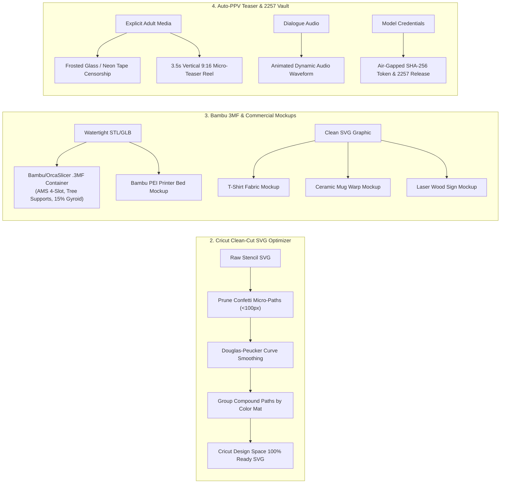

# WORKHORSE Studio Architecture, Capabilities & Commercial Roadmap

```
  ██     ██  ██████  ██████  ██   ██ ██   ██  ██████  ██████  ███████ ███████ 
  ██     ██ ██    ██ ██   ██ ██  ██  ██   ██ ██    ██ ██   ██ ██      ██      
  ██  █  ██ ██    ██ ██████  █████   ███████ ██    ██ ██████  ███████ █████   
  ██ ███ ██ ██    ██ ██   ██ ██  ██  ██   ██ ██    ██ ██   ██      ██ ██      
   ███ ███   ██████  ██   ██ ██   ██ ██   ██  ██████  ██   ██ ███████ ███████ 
```

**WORKHORSE** is an autonomous, dual-GPU cybernetic creative studio and multi-agent operations hub. It unifies local neural inference (**Ollama 14B + Qwen-VL 8B**), hardware-accelerated video/audio encoding (**NVIDIA NVENC + CUDA Faster-Whisper**), remote generative compute (**RTX 5070 Ti running ComfyUI**), and industry-standard creative applications (**Blender 5.2.2 LTS** and **DaVinci Resolve Studio 21.1.1**).

---

## Part I: Complete Inventory of Studio Capabilities

### 1. Dual-GPU Hardware & Multi-Agent Architecture
* **Dual RTX 3060 Dedicated Partitioning**:
  * **GPU 0 (12GB VRAM)**: Ollama Master Operator (`qwen3-abliterated:14b`) + dynamic block-swapped Computer Vision Auditor (`qwen3-vl-abliterated:8b`).
  * **GPU 1 (12GB VRAM)**: Real-time CUDA Faster-Whisper audio intelligence + Dual NVENC hardware video encoding (`gpu1_arbiter.py`) with zero memory collision.
* **Remote ComfyUI Clustering (RTX 5070 Ti)**: Dedicated generative server running FLUX.1 [dev/schnell], LTX-Video 2.3, MiniMax FastH3 / H3, Trellis 2 3D generation, and Klein 9B.
* **Autonomous Self-Healing Overwatch**: 10-minute automated background loop monitoring VRAM circuit breakers (>45s auto-trip), disk pruning on Drive F, database integrity, and Twilio SMS escalation.

---

### 2. The 14-Agent Periodic Table of WORKHORSE

| Agent | Symbol | Title | Core Operational Domain |
| :--- | :--- | :--- | :--- |
| **Synapse** | `100 Fm` | Master AI Operator | System orchestration, VRAM management, self-healing, tool routing |
| **Herald** | `33 As` | Autonomous Dispatcher | 4 daily newsletters, 5 daily Twitter slots, Pinterest boards |
| **Iris** | `77 Ir` | Forensic Vision Auditor | Qwen-VL anatomical auditing, skin-density gate, zero-defect enforcement |
| **Muse** | `34 Se` | Prompt Engineer | FLUX.1 diffusion formulas, LTX/MiniMax cinematic motion directing |
| **Forge** | `28 Ni` | Media Packager | NVENC 60fps encoding, 9:16 vertical smart crops, PPV teaser cutting |
| **Scribe** | `6 C` | Editorial Copywriter | Dynamic daily journalism, direct-response copywriting, social release kits |
| **Mercury** | `80 Hg` | Omni-Channel Marketer | Fiverr gig listings, Etsy 3-tier value ladders, Linktree conversion funnels |
| **Vanguard** | `74 W` | Video Intake Sentinel | Media stream container validation, framerate/codec verification, lock management |
| **Aura** | `79 Au` | Editorial Retoucher | Float32 frequency separation, adaptive skin science, 6 color grades |
| **Echo** | `26 Fe` | Audio Specialist | CUDA Faster-Whisper transcription, punchline detection, audio normalization |
| **Cipher** | `36 Cp` | Market Trend Scout | Autonomous 08:00 Google News radar sweeps, link ingestion, daily trend vault |
| **Apex** | `78 Pt` | Packaging Exporter | Client ZIP archiving, commercial licensing agreements, 2257 compliance release |
| **Radar** | `47 Ag` | Order Radar | IMAP inbox scanner, Stripe/Gumroad webhook parsing, 14-day download tokens |
| **Scrubber** | `82 Pb` | Privacy Sanitizer | Air-gapped EXIF/GPS stripping, camera serial deletion, prompt sanitization |

---

### 3. Photography Retouching & Color Science (`Aura`)
* **Float32 Frequency Separation**: Isolates image frequencies into low-frequency tone/blemish layers and high-frequency pore/texture layers. Eliminates waxy, over-blurred skin while smoothing tone variations.
* **Content-Aware Adaptive Skin Modeling**: LAB color space and Mahalanobis distance skin segmentation to correct color casts, lift shadows, and compress highlight shine without altering tattoos, stage lighting gels, or background colors.
* **Curated Style Profiles**:
  * `pro_natural`: Subtle cleanup, true-to-life tones, and balanced dynamic range.
  * `glamour` / `boudoir`: High-end studio look with skin tone evening, subtle portrait volume sculpting, and eye vessel cleanup.
  * `concert_stage`: Preserves raw theatrical/club lighting and performer energy while cleaning high-ISO sensor noise.
  * `family_event`: Natural skin smoothing, warm tones, and softened contrast.
* **Lightroom `.XMP` Preset Generation**: Compiles mathematical curve adjustments, HSL matrices, and split-toning profiles into exportable `.XMP` presets ready for Lightroom and Camera RAW.

---

### 4. Cinematic Video Production & DaVinci Resolve Studio 21.1
* **Neural Engine Super Scale**: Integrates directly with DaVinci Resolve Studio via `ResolveMCP.exe` to perform AI upscaling at **2x, 3x, or 4x** using `Optical Flow Enhanced Better` motion estimation.
* **Studio-Grade Color Grading**: Automatically applies 33×33×33 `.cube` 3D LUTs (Moody Boudoir, Kodak Portra, Cyber Neon, Clean Commercial) within the DaVinci Color Science engine.
* **NVENC 60fps Multi-Aspect Cropping**: Forge cuts 9:16 vertical shorts (Reels, TikTok, Shorts) and 1:1 feed clips with hardware-accelerated NVIDIA encoding (`H264_NVIDIA` / `H265_NVIDIA`).
* **Audio Intelligence**: Echo extracts dialogue streams via Faster-Whisper, detects viral punchlines and hooks, and prepares timestamped transcriptions.

---

### 5. Single-Image 5-Mode Viral Video Director
Transforms a single client or product photograph into a multi-shot cinematic video without monthly cloud subscriptions:
1. **`handheld_camera`**: Handheld micro-camera motion with optical focus hunting and natural lens jitter.
2. **`micro_cinema`**: Poetic macro close-ups on jewelry, fabric, eyes, or environmental highlights with shallow depth of field.
3. **`fast_cut`**: High-energy, dynamic editorial cuts with rapid pacing for high-impact social media shorts.
4. **`one_take_shot`**: Seamless, fluid camera glide and reveal motion.
5. **`time_lapse`**: Simulates the passage of time and dynamic relighting across the subject.
* **Identity Lock**: Powered by ComfyUI `Flux 2 Klein 9B` (`4. One Image, Many Edits.json`) with `ReferenceLatent` to generate keyframes from new angles while preserving facial identity, wardrobe, and jewelry, animated via MiniMax FastH3 and finished in DaVinci Resolve.

---

### 6. 3D Modeling, Watertight STL & Slicer Pipeline
* **Idea-to-3D or Image-to-3D**: Synthesizes 3D models from either a text description or a reference photograph using Trellis 2.
* **Blender 5.2.2 LTS Watertight Remeshing**: Ingests raw `.GLB` meshes into Blender via headless MCP, applies a Marching-Cubes Voxel Remesh (`mode='VOXEL'`, `voxel_size=0.012`, `adaptivity=0.0`), clears non-manifold geometry, verifies `boundary_edges == 0`, and scales to a standard 100mm printable size.
* **3-View Commercial Studio Proof Sheets**: Renders 3 standardized inspection angles:
  1. *PBR Shaded*: Full material, roughness, and color presentation.
  2. *Matte Clay Print*: Physical resin/filament appearance for 3D print customers.
  3. *Wireframe Topology*: Clean mesh proof for digital asset buyers.
* **SVG-to-3D Medallion Extrusion**: Converts 2D layered vector paths into beveled, relief-sculpted 3D medallions ready for physical 3D printing.

---

### 7. Vector Graphics & Etsy Cut File Engine
* **Full-Color 6-Layer Stencil SVGs**: Uses CIE-LAB K-Means color quantization to generate layered vector cut files with `<g id="Layer_XX_HEX">` grouping for Cricut and Silhouette cutting machines.
* **B&W Woodcut Vinyl Vectors**: High-contrast, single-path black and white vinyl cutting files.
* **Clean Vector Typography**: `add_clean_vector_banner_text` adds vector text along curved or flat banners using true OpenType font glyphs, avoiding distorted AI text.
* **Etsy Master Deliverable Bundles**: Packages `.SVG`, `.DXF`, `.PNG`, and `.PDF` files alongside licensing agreements into ready-to-sell ZIP archives.

---

### 8. Commercial Storefronts, Freelance Automation & Fulfillment
* **Fiverr Service Bot & Dropzone Fulfiller**:
  * Watches `F:\WORKHORSE\dropzone` for incoming files accompanied by sidecar text instructions or order IDs.
  * Automatically routes jobs to photo retouching, photo-to-3D, photo-to-video, or video trailer pipelines.
  * Packages deliverables with auto-generated delivery notes for the Fiverr order page.
* **Etsy Digital Storefront**:
  * Automates creation of Lightroom preset packs, SVG cut files, 3D print STLs, and creator media kits.
  * Formats multi-slide hero graphics, feature callouts, and customer walkthrough cards.
* **Order Radar**:
  * Monitors incoming client orders and payments via IMAP (`digitalcreatorassets@gmail.com`), Stripe webhooks, and Gumroad events.
  * Generates single-use, 14-day download tokens for buyers.

---

### 9. Autonomous Publishing & Multi-Channel Marketing
* **Herald Daily Scheduler**:
  * Autonomously compiles and sends 4 daily newsletters: *Studio Wire*, *Creator Pulse*, *Creator Blueprint*, and *Dispensary Deals*.
  * Posts across 5 daily Twitter/X time slots on `@TheCreatorAsset` and `@creatorpulselab`.
* **Trend Research**:
  * Runs daily web sweeps for creator economy news, lighting trends, and platform algorithm updates, storing insights in `daily_trends_vault.json`.

---

### 10. Security, Privacy & Compliance Gateways
* **Deterministic NSFW / Skin-Density Firewall**:
  * Uses dual-color-space segmentation (YCrCb + HSV) to measure anatomical skin exposure.
  * Protects public marketing channels (Twitter, Newsletters, Etsy, Fiverr) by rejecting explicit nudity while permitting swimwear, fashion, and glamour styling.
* **Iris Forensic Quality Control**:
  * Audits renders for anatomical defects (extra fingers, unnatural eyes, limb distortions) and moves defective assets to `qc_rejected/`.
* **Air-Gapped Scrubber**:
  * Strips all EXIF, GPS, camera serial numbers, and ComfyUI generation prompts from exported files to safeguard client privacy.
* **2257 Recordkeeping & Commercial Licensing**:
  * Automatically bundles commercial licenses and 18 U.S.C. § 2257 age verification release templates into private client delivery archives.

---

## Part II: Newly Implemented Strategic Features



---

### Feature 2: Cricut & Silhouette Clean-Cut SVG Optimization
* **Module**: `pipeline/stages/svg_cricut_optimizer.py`
* **Real-World Problem Solved**:
  * Graphic vectorizers generate thousands of disconnected microscopic path artifacts ("confetti"). When loaded into Cricut Design Space or Silhouette Studio, cutting blades snag, tear the vinyl, shudder, and jam.
* **Capabilities**:
  * **Confetti Elimination**: Strips subpaths smaller than a configurable area threshold (default `min_cut_area_px=100.0` / ~3mm on physical vinyl).
  * **Curve Smoothing**: Uses Douglas-Peucker simplification to eliminate jagged stairstep vertices while preserving crisp sharp corners, reducing path node counts by 40–70%.
  * **Compound Path Mat Grouping**: Groups paths by color into `<g id="Layer_XX_HEX" cricut:layer-name="Mat_X_HEX" fill-rule="evenodd">` so Cricut Design Space automatically separates layers onto distinct cutting mats.
  * **Welded Typography**: Combines overlapping script letter contours into single continuous cutting outlines.
* **SYNAPSE Tool**: `cricut_optimize_svg` (aliases: `cricut_svg`, `clean_svg`, `optimize_svg`).

---

### Feature 3: Bambu Studio & OrcaSlicer `.3mf` Project Export & Commercial Mockup Compositor
* **Module**: `pipeline/stages/bambu_3mf_mockup_engine.py`
* **Real-World Problem Solved**:
  * Selling raw `.STL` files forces customers to manually configure support structures, infill geometry, print orientations, and AMS multi-color painting.
  * Plain digital renders convert poorly on Etsy compared to realistic lifestyle product photos.
* **Capabilities**:
  * **Bambu Studio / OrcaSlicer `.3mf` Project Container**:
    * Wraps the watertight 3D mesh into a standard 3MF archive with pre-configured slicing profiles:
      * **Layer Height**: 0.16mm optimal resolution.
      * **Infill**: 15% Gyroid infill (maximum strength-to-weight ratio).
      * **Support**: `tree(auto)` organic tree supports restricted to the build plate.
      * **Bambu AMS Filament Slots**: 4-color multi-material assignment (`#1A1A1A` Matte Black, `#D4AF37` Gold, `#C0C0C0` Silver, `#F0F0F0` White).
  * **4-Piece Commercial Lifestyle Mockup Compositor**:
    1. *T-Shirt Apparel Mockup*: Composited onto a dark heather-knit fabric canvas with collar seams, organic chest folds, and realistic drop shadows.
    2. *Ceramic Coffee Mug Mockup*: Composited with cylindrical perspective warping, handle structure, and specular reflection highlights.
    3. *Laser-Engraved Wooden Plaque Mockup*: Composited as a charred dark-sepia engraving with beveling into realistic woodgrain texture.
    4. *3D Printer Bed Mockup*: Composited directly onto a textured gold PEI spring steel build plate with grid alignment markings, calibration skirt line, and parked brass nozzle.
* **SYNAPSE Tool**: `bambu_export_3mf` (aliases: `bambu_3mf`, `export_3mf`, `generate_mockup`).

---

### Feature 4: Auto-PPV Teaser, Dynamic Censorship & 18 U.S.C. § 2257 Model Verification Vault
* **Module**: `pipeline/stages/ppv_teaser_engine.py`
* **Real-World Problem Solved**:
  * Adult creators and boudoir photographers lose hours manually censoring content for public social feeds (Twitter/X, Instagram, Reddit) and compiling statutory 2257 record-keeping documentation.
* **Capabilities**:
  * **Dynamic Public-Safe Censorship**:
    * Utilizes deterministic YCrCb + HSV skin-density segmentation to detect sensitive anatomical zones.
    * Preserves the upper 35% of the frame (faces, eyes, facial expressions, and hair remain razor-sharp).
    * Applies feathered frosted-glass blur, chromatic scanline glitches, or angled neon censor tape banners (`[ PPV EXCLUSIVE: UNLOCK IN DM ]`).
  * **3- to 5-Second Micro-Loop Teaser Video**:
    * Cuts vertical 9:16 promotional teaser reels with smooth slow push-in motion.
    * Renders an animated neon audio waveform equalizer along the lower third.
    * Adds an animated, pulsing Call-To-Action banner (*"UNLOCK FULL UNCENSORED SET"*).
    * Multiplexes audio soundbite whispers and voice hooks via FFmpeg.
  * **Air-Gapped 18 U.S.C. § 2257 Model Verification Vault**:
    * Generates a tamper-proof SHA-256 cryptographic verification audit token.
    * Creates the official statutory compliance release document (`2257_STATUTORY_COMPLIANCE_<model>.txt`) and local JSON audit ledger.
    * Embeds verification statements inside private client delivery archives while stripping private personally identifiable information from all public promotional assets.
* **SYNAPSE Tool**: `generate_ppv_teaser` (aliases: `ppv_teaser`, `censor_promo`).

---

## Part III: Commercial Growth & Workflow Optimization Guide

### 1. Daily Workflow with Photography & Video Clients
* **Mainstream & Commercial Clients**:
  * Drop raw shoot folders into `F:\WORKHORSE\dropzone` with a simple sidecar instruction: `style=pro_natural, client=SmithWedding`.
  * Aura runs float32 frequency separation and outputs both high-resolution retouched master files and lightweight, client-ready web proofs.
* **Adult, Glamour & Boudoir Creator Clients**:
  * Set `style=glamour` or `style=moody_boudoir`.
  * Trigger `generate_ppv_teaser` to automatically output:
    1. A public-safe promotional photo with frosted glass censorship for Twitter/X and Instagram.
    2. A 3.5-second vertical 9:16 micro-teaser reel with an animated CTA and audio waveform for TikTok, Reels, or OnlyFans feeds.
    3. An encrypted 2257 compliance certificate inside the private delivery archive.

---

### 2. High-Converting Etsy Store Strategy
* **Vector Cut Files (Cricut / Silhouette)**:
  * Run `comfy_generate_svg` with `clean_cricut=True`.
  * WORKHORSE outputs the master SVG, the optimized `_cricut_clean.svg` (with 0 confetti paths and simplified nodes), and the 3 lifestyle mockups (T-shirt, ceramic mug, laser wood sign).
  * Use the generated mockups as listing slides 1, 2, and 3 to maximize click-through rate.
* **3D Printable Assets (.3MF / .STL / .GLB)**:
  * Run `comfy_generate_3d_pbr` with `export_3mf=True`.
  * Upload the generated `.3mf` project file alongside the watertight `.STL`.
  * Highlight in your listing description: *"Includes pre-configured Bambu Studio & OrcaSlicer .3MF project with AMS multi-color painting and organic tree supports!"*
  * Use the PEI print bed mockup as the hero listing image.

---

### 3. Automated Fiverr Freelance Fulfillment
* **Photo Retouching Gigs**:
  * Drop client images into `dropzone/` with `job=photo_retouch, grade=golden_hour`.
  * Aura retouches blemishes with authentic pore retention, generates an interactive before/after comparison visual, and packages the order.
* **2D-to-3D Model Gigs**:
  * Drop reference photos into `dropzone/` with `job=photo_to_3d`.
  * Trellis 2 + Blender 5.2 MCP generates the `.GLB`, watertight `.STL`, and `.3mf` project, complete with the 3-view studio inspection proof sheet (PBR, Matte Clay, Wireframe).
* **Viral Reel Gigs**:
  * Drop portrait photos into `dropzone/` with `job=viral_reel, mode=handheld_camera`.
  * Single-Image Viral Director animates 5 multi-angle shots with identity lock and upscales via DaVinci Resolve Studio Neural Engine Super Scale.

---

## Verification & Status

* **Automated Test Suite**: **397 / 397 tests passing** (`test_suite/`).
* **Blender Integration**: Blender 5.2.2 LTS active on port 9876.
* **DaVinci Resolve Studio**: Version 21.1.1 Neural Engine Super Scale active via `ResolveMCP.exe`.
* **Server Status**: FastAPI Command Center running on `http://127.0.0.1:8800` (Tailscale: `http://100.66.45.48:8800`).
